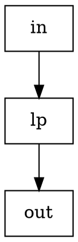
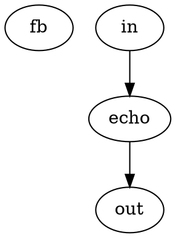

# Filter & synth graphs (fundsp)

Hey Listen has **two Workbench graph editors** — the **filter** graph and the **synth**
graph — built from **one shared node catalog** and compiled to a fundsp `Net`. The stored
form is a `GraphSpec`; its canonical text form is **DOT** (`GraphSpec → DOT → GraphSpec` is
identity). See `docs/graph-editor.md` for the design; this file is the *driving* surface.

`list_nodes` / `get_node` (MCP) and `nodes [KIND]` (CLI) are the **authoritative catalog** —
exact ports, param keys/defaults/min/max/step/unit, and a ready-to-paste DOT skeleton. Use
them; **never guess a port name or a param key.** This file is a curated map of *what each
node is for* plus the non-obvious facts, not a restatement of the catalog.

## One model, two graphs

| | Filter graph | Synth graph |
| --- | --- | --- |
| Global input | **1** (mono) — the `input` node | **0** — sound generators |
| Global output | **1** (mono) — the `output` node | **1** (mono) — the `output` node |
| Where it runs | Upstream of **preview and every analyzer** (after channel select → mono) | Rendered to **48 kHz mono PCM** by `render_synth` → becomes the source |
| Installed by | `set_filter_graph` | `render_synth` / Live |

Both compile to a **mono net** (`Net::new(inputs, 1)`). There is **no implicit summing** —
only what is wired into `output` is heard. `GraphSpec`/DOT/subsystems/snoop are identical
across the two; the only difference is the anchors and whether generators are offered.

### The mono-net constraint (read this)

The net's global I/O is **mono** even though nodes may be **stereo internally** (`split`
1→2, `pan` 1→2, `panner`/`rotate`/`limiter_stereo`/`reverb*_stereo` 2→2, `join` 2→1). Wire
`input → split → (stereo FX) → join → output`; a floating stereo channel is simply not
heard, and `join` **averages** back to mono. **You cannot output true stereo from Hey
Listen — design for mono.**

### Anchors

- `input` (filter only, 0→1) — the graph's entry, fed from the global input. Exactly one.
- `output` (1→0) — the graph's exit. Exactly one, in **both** graphs.
- A fresh filter seeds as `input → output` (identity); a synth seeds as `sine → output`.

### Rules (enforced in UI and core)

- Exactly one `input` (filter) and exactly one `output` (both).
- **One source per input** — a second edge into an occupied input is rejected
  (`InputConflict`).
- No cycles, no self-links. Unknown kinds/ports/params are errors.

## Discovery — never guess

```
list_nodes                # every kind (category, arity, port names, params, hint)
get_node { kind }         # one kind + a ready-to-paste DOT skeleton with defaults
nodes [KIND]              # CLI equivalent (table, or --json; <KIND> = one kind's detail)
```

`get_node`'s skeleton shows the exact `kind=` and keyed params at their defaults, so you can
author DOT by copy-and-tweak instead of remembering arities. `get_graph { graph: filter|synth }`
reads the current graph back as DOT.

## Node map

Categories are `NodeCategory` (the palette groups). Fixed-parameter filters use the `*_hz`
constructors (one audio input, params are positional); **control-input** variants (`*_cv`)
take cut-off/Q/gain from extra inputs fed by `dc`/`sine_lfo` (input 0 is always the audio).

### IO / routing (`Io`, `Mixer`)

`input` (filter only), `output`, `mix` (sum A+B, 2→1), `split` (1→2 copy), `join` (2→1
average). `mix` is the routing twin of the math `add` — for two inputs they are equivalent;
prefer `mix` to *route* and `add` to *arithmetic*.

### Math (`Math`, 2→1 binary / 1→1 unary)

`add`, `subtract` (A−B), `multiply`, `divide`, `min`, `max`, `abs` (rectify), `invert`
(polarity flip). **`multiply` is your VCA / ring-mod**: feed one input from `dc`/`sine_lfo`.
There is no dedicated gain-for-signal node beyond `gain` (see filters); `multiply` by `dc`
is the general "scale by a constant".

### Generators (`Generator`, synth only — fixed `freq`, no pitch CV)

`sine`, `saw`, `square`, `triangle`, `ramp` (0→1 phasor), `rossler`/`lorenz` (chaotic),
`organ`/`hammond` (additive), `soft_saw`, `pulse` (freq + width 0..1), `poly_saw` /
`poly_square` / `poly_pulse` (band-limited), `dsf_saw` / `dsf_square` (freq + roughness
0..1), `pluck` (Karplus–Strong: freq + **decay in 1/s** + damping 0..1), `white` / `pink` /
`brown` / `mls` (noise), `zero` (silence, drives an unused input), `impulse` (one sample).

> **Oscillators have a fixed `freq` — there is no audio-rate or envelope pitch CV.** To get
> a decaying pitched tone use `pluck` (built-in decay + damping); `ramp` is the only
> freely-usable phase/rate signal. Modulate **amplitude** (→ `multiply`) or **filter
> cutoff** (→ `*_cv`), not oscillator pitch.

### Filters (`Processor`, fixed params)

`gain` (amplitude, see below), `fir3` (3-tap smoother), `convolve` (synthetic-IR convolution
reverb: time + tone), then the SVF family — `lowpass`, `highpass`, `bandpass`, `notch`,
`peak`, `allpass`, `bell` (freq+q+gain), `lowshelf`/`highshelf` (freq+q+gain) — plus `moog`
(ladder), `butterpass`, `lowpole`/`highpole` (one-pole), `lowrez`/`bandrez` (resonant),
`resonator` (freq + bandwidth in Hz), `morph` (freq+q+morph −1..1), `pinkpass` (pink tilt),
`allpole_delay` (delay in **samples**), `biquad` (a1,a2,b0,b1,b2), `dcblock`, `delay`
(seconds), `clip_to` (min/max), `declick` (fade-in seconds), `dcblock_hz` (cutoff), `pan`
(1→2), `panner` (audio+pan → 2), `rotate` (2→2, angle+gain).

### Filter CV (`FilterCv`, control-driven)

`lowpass_cv`, `highpass_cv`, `bandpass_cv`, `notch_cv`, `peak_cv`, `allpass_cv` (audio, cut,
Q); `bell_cv` / `lowshelf_cv` / `highshelf_cv` (audio, cut, Q, gain); `moog_cv` / `lowrez_cv`
/ `bandrez_cv` (audio, cut, Q); `resonator_cv` (audio, center, bw); `morph_cv` (audio, cut,
Q, morph); `butterpass_cv` / `lowpole_cv` / `highpole_cv` (audio, cut); `allpole_cv` (audio,
delay-samples). Every control input is smoothed with a one-pole `follow` (0.01 s), so a
`sine_lfo` cutoff sweep glides instead of stepping.

### Shapers (`Processor`)

`tanh`, `atan`, `softsign` (drive/hardness), `crush`, `soft_crush` (quantization levels).
Warmth/distortion = `tanh`; lo-fi = `crush`.

### Dynamics (`Dynamics`)

`limiter` (mono), `limiter_stereo` (2→2), `compressor` (threshold dB, ratio, attack,
release), `gate` (threshold dB, attack, release). `compressor`/`gate` are custom units —
fundsp ships neither.

### Modulation (`Modulation`)

`chorus` (spread, depth, rate), `flanger` (feedback, min, max, rate), `phaser` (feedback,
rate). The go-to movement effects.

### Reverb (`Reverb`)

`schroeder` / `schroeder_cv` (mono all-pass diffusion; **stack several** to build a cheap
mono reverb), `reverb_stereo` (32-ch FDN, room+damping), `reverb2_stereo` (hq),
`reverb3_stereo`, `reverb4_stereo` (fade-in). The `*_stereo` reverbs are **2→2** — wrap them
in `split … join`. `room` is in **metres** (min 10/15), `time` is decay in seconds.

### Control (`Control`)

`dc` (constant; huge range so it can set freq/time inputs in their own units), `sine_lfo`
(rate + amount + offset; the standard modulator), `follow` (one-pole smoother),
`afollow` (separate attack/release), `hold` (sample-and-hold), `tap` / `tap_linear`
(variable delay), `snoop` (see below).

### Subsystems (`Subsystem`, see below)

`subgraph`, `feedback`, `oversample`, `resample` — each wraps an inner `GraphSpec`.

## GraphSpec (the JSON form)

```json
{
  "nodes": [
    { "id": "osc", "kind": "sine", "params": [220.0] },
    { "id": "out", "kind": "output", "params": [] }
  ],
  "edges": [
    { "from": "osc", "from_port": 0, "to": "out", "to_port": 0 }
  ]
}
```

- `params` is **positional**, in catalog order (same order `get_node` lists them). Omitted
  values take the catalog default.
- `subgraph` (optional `GraphSpec`) is present only on a `subsystem` kind.
- `edges` reference nodes by `id`; a port is the index into the node's `input_ports` /
  `output_ports` (see `get_node`). `from_port`/`to_port` default to 0.

## DOT interchange

DOT is the canonical text form. A node is a statement with `kind` + **keyed** params; a node
with >1 input or output is a **record** whose `label` names each port, so an edge writes
`src:out -> dst:cut`:



- Params resolve against the catalog: unknown key / out-of-range value / unknown port /
  missing port on a multi-port node are **errors**; omitted keys take defaults.
- A DOT string may open with `//`, `/* … */` or `#` comment lines — the header keyword is
  looked for past them.
- `get_graph` reads a graph back as DOT; `get_node` returns a DOT skeleton. `set_filter_graph`
  / `render_synth` accept DOT text, a `graphFile` path, or a `GraphSpec` object.

## Subsystems

fundsp combinators that wrap an **inner graph** — `subgraph` (reusable chain), `feedback`
(fundsp `feedback`), `oversample` (anti-alias), `resample` (inner generator; input 0 = speed).
The node owns a nested `GraphSpec` (`subgraph`), edited in its own tab; the inner graph has
its own mono `input`→`output` (a `resample` inner graph takes **no input** — it is
generator-seeded). In DOT a subsystem node names its block and nests a real `subgraph`:



## Snoop

`snoop` (a `Control` node, param `capacity` = ring-buffer samples) passes its signal through
and shows a **live envelope** on the node card. `graph_snoop { scope, node, points }` reads
it; scope is `filter`, `synth`, or a subsystem path (`filter/feedback-3`). Add a `snoop`
anywhere you want to *see* the level — cheap, and it catches clipping (envelope clamps at ±1).

## Sound design — get it sounding good fast

1. **Layer + mix.** One oscillator is thin. Stack `saw` + `square` + `sine` (or two detuned
   copies) through `mix`, then shape. `organ`/`hammond` already bundle rich harmonics.
2. **Shape timbre with filters.** `lowpass`/`moog` warm a bright source; `bandpass`/`peak`
   focus a band; `lowshelf`/`highshelf` balance. A `lowpass` sweep (via `lowpass_cv` +
   `sine_lfo`) is the classic movement.
3. **Movement.** `chorus`/`flanger`/`phaser` for width and motion; `sine_lfo → multiply` for
   tremolo. No pitch vibrato (fixed-freq oscillators) — sweep the filter instead.
4. **Notes/plucks.** `pluck` (freq + decay + damping) gives a decaying pitched tone; follow
   with `lowpass` and `reverb_stereo` (via `split … join`) for a pad-like tail.
5. **Percussion/drones.** `white`/`pink` → `lowpass`/`bandpass` for a hat or rumble;
   continuous oscillators + slow tremolo + reverb for a pad/drone.
6. **Hygiene, in order.** `declick` first (fade-in), `dcblock` per channel (remove DC), `gain`
   for headroom, `limiter` **last** (never clip). Watch gain when layering — the net is mono
   and sums, so keep each layer ≤ ~0.5 and a final `limiter` to catch peaks. Use `snoop` to
   confirm you're not pinning at ±1.

## Workflow

1. `get_state` — once: server mode (`bridge`/`headless`), whether a source/filter is set.
2. `list_nodes` / `get_node { kind }` — pick nodes; copy the DOT skeleton. (CLI: `nodes
   [KIND]`.)
3. Build the spec as DOT or JSON, then install it:
   - **filter** → `set_filter_graph { graph, enabled: true }` (runs upstream of preview +
     analysis; the Filter switch bypasses it).
   - **synth** → `render_synth { graph, seconds }` (renders 48 kHz mono and **adopts it as
     the source**), or set the editor graph with `set_synth_graph` (app-only).
4. `get_graph { graph }` to read it back as DOT and confirm it compiled.
5. `run_analysis` / `preview` to hear/measure the result; iterate on params.
6. Mutating tools are read-modify-write — call **sequentially**.

## Gotchas

1. **`gain` is linear amplitude, not dB** — `1` is flat, `0..16`. For a cut use `<1`. The
   math `multiply` by `dc` is the general scale. Polarity flip is the `invert` node (the
   `gain` param is clamped ≥ 0).
2. **Bell/shelf `gain` goes through `sqrt`** in fundsp, so it must stay strictly positive
   (the catalog floor is 0.001). Below 1 cuts, above 1 boosts — but non-linearly.
3. **`fir3`'s "gain" is the Nyquist gain**, not an amplitude: `0` = full low-pass, `1` =
   pass-through.
4. **`pluck` is a single shot** — triggered at t=0, then decays. `decay` is in **1/s**,
   `damping` in 0..1.
5. **`allpole_delay` takes samples, not seconds**; `resonator`'s second param is a bandwidth
   in **Hz**; reverb `room` is in **metres**.
6. **Mono net** — stereo is internal only; `join` averages. A "stereo" reverb must be
   wrapped `split … join`, and the output is still mono.
7. **Fixed-frequency oscillators** — no pitch CV, so no audio-rate FM or pitch vibrato.
   Modulate amplitude or filter cutoff instead.
8. **`render_synth` replaces the source** (the whole timeline). The Live path
   (`update_synth_source`) overwrites in place, preserving window/zoom/annotations; it is a
   persisted app-chrome preference, not per-project state.
