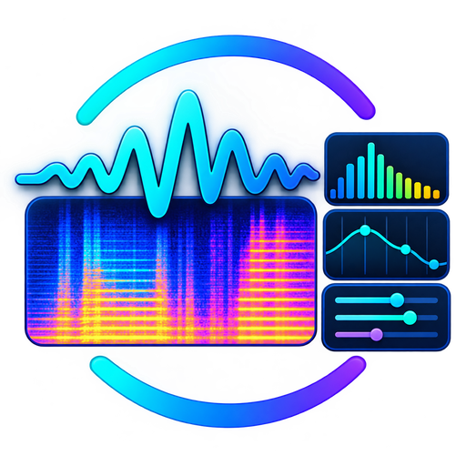

# Hey Listen

An audio analysis workbench: capture, filter, and analyze sound from files, live inputs, and synthesis.

> **AI assistance:** This project was scaffolded and developed with the help of AI
> coding agents. AI-generated code and documentation should be reviewed before
> relying on it.

## What it does



- **Source.** Open an audio file, capture live (microphone, system loopback,
  per-process, or mic+system mix), or synthesize with fundsp. One window = one
  project = one source.
- **Filter.** A Filter graph runs upstream of playback *and* every analyzer; a
  Synth tab renders fundsp synthesis into the timeline.
- **Analyze.** ~27 analyzers, computed off the main thread so the UI stays live:
  waveform, levels, and the frame-RMS amplitude envelope; spectrum, spectrogram, mel
  spectrogram, MFCC, chromagram, and the spectral descriptors; pitch (pYIN / YIN /
  autocorrelation); tempo, onsets, and downbeats; and EBU R128 loudness. Shared params
  stay synced across tools; dockable tabs, no duplicates.
- **Save.** Raw audio plus source, graphs, setup, and layout go into one binary
  `.heyl` project file.

**Drive it from an agent.** A built-in
[Model Context Protocol](https://modelcontextprotocol.io) server lets an AI agent
open sources, run every tool, edit graphs, preview, and save on the live window.

**Batch it from a shell.** `hey-listen analyze <FILE>...` runs the same engine
over files with no window, printing one JSON object per file/tool.

## For developers

The one rule worth reading first: **Timeline, Sidebar, Workbench, and Source are
fixed regions, not tabs.** The only tabs are the Workbench tabs — the graph
editors (filter / synth) and the analyzer tools — and they live inside the
Workbench, managed by `dockview`.

Two processes, one boundary: a Rust core (all audio I/O, decode, analysis, the
project file, and cross-window UI state) and a SolidJS frontend (layout, tabs,
graph editing, charts). They talk only over the Tauri IPC boundary; PCM crosses
solely through ordered `tauri::ipc::Channel` streams. Analysis runs off the main
thread with debounced auto-run.

## Documentation

`docs/` is the source of truth for design; keep it in sync when decisions change.
Start with the [architecture](docs/architecture.md) and
[roadmap](docs/roadmap.md), then the doc for the area you're touching.

- [Architecture](docs/architecture.md) — processes, IPC boundary, module layout, threading
- [UI layout](docs/ui-layout.md) — the fixed-region + Workbench-tabs rule
- [Graph editor](docs/graph-editor.md) — the fundsp Net model and node palette
- [Source model](docs/source-model.md) — audio sources and timeline behavior
- [Data model](docs/data-model.md) — domain entities and relationships
- [Project file format](docs/project-file-format.md) — binary layout and streaming
- [Analysis tools](docs/analysis-tools.md) — oxiaudio inventory, tool/tab model, shared params
- [MCP server](docs/mcp.md) — agent access, the stdio bridge, UI following
- [Batch CLI](docs/cli.md) — `hey-listen analyze`: bulk-analyze files from a shell, no window
- [Agent skill — audio analysis](.agents/skills/audio-analysis/SKILL.md) — driving the engine via the MCP server or the batch CLI
- [Dependencies & licenses](docs/dependencies.md)
- [Packaging](docs/packaging.md) — release/CI process and the build matrix
- [Testing](docs/testing.md) — E2E plan and test matrix
- [Decisions (ADRs)](docs/decisions.md)
- [Roadmap](docs/roadmap.md) — phased milestones and status

## Build and dependencies

Requires Rust ≥ 1.90 and Node ≥ 22.19 (the E2E toolchain's `undici` uses
`zlib.createZstdDecompress`, added in Node 22.19). Prefer the npm Tauri CLI over a
`cargo`-installed one (they drift; see [`docs/dependencies.md`](docs/dependencies.md)).

```sh
npm install
npm run tauri dev
```

Other scripts: `npm run dev` (Vite only), `npm run build`, `npm run typecheck`.
Run `cargo check` in `src-tauri/` for the Rust side — the first build is slow
(many deps). Run `cargo test` after changing a boundary type: it regenerates the
TypeScript bindings in `src/bindings/`.

The core stack: [Tauri 2](https://v2.tauri.app) +
[SolidJS](https://www.solidjs.com)/TypeScript/Vite, with
[`@kobalte/core`](https://kobalte.dev) primitives, [`dockview`](https://dockview.dev)
for the Workbench tabs, [`@dschz/solid-flow`](https://github.com/dsnchz/solid-flow)
for the graph editor, and [`@dschz/solid-uplot`](https://github.com/dsnchz/solid-uplot) +
`uplot` for charts. Audio in Rust: [`flexaudio`](https://crates.io/crates/flexaudio)
(capture), [`symphonia`](https://crates.io/crates/symphonia) (decode),
[`fundsp`](https://crates.io/crates/fundsp) (filter/synth), and
[`oxiaudio`](https://crates.io/crates/oxiaudio) (analysis). Full versions,
rationale, and licenses are in [`docs/dependencies.md`](docs/dependencies.md).

If `npm install` hits `EPERM` from a root-owned `~/.npm`, use a project-local
cache: `npm_config_cache=/Users/anvlkv/Projects/hey-listen/.npm-cache npm install`.
