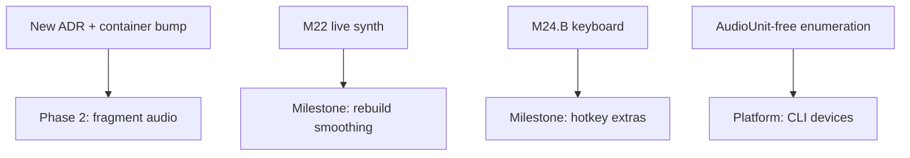

# Deferred work — ledger and delivery plan

This is the **single owner** of what Hey Listen has deliberately not shipped: one row per
item, with its blocker and the phase it belongs to. Area docs keep the *technical reason* a
thing is hard (the node model cannot express a `Sequencer`; a batch tool must not prompt);
they point here instead of keeping their own backlog list. When an item ships, **delete its
row** and mark it delivered in the owning milestone — a "done" table here would only rot.

Phases are an order, not a commitment: the roadmap rule still holds ("deliver one
milestone at a time; only start when asked"). An item leaves this file the moment it ships;
the owning milestone/doc records the delivery.

## States

| State | Meaning |
| --- | --- |
| `now` | Deliverable today: no decision, milestone, or platform work in the way. |
| `decision` | Waiting on an architecture decision (an ADR amendment or a new ADR). |
| `milestone` | Waiting on a planned milestone (M13, M22, M24.B). |
| `platform` | Waiting on work nobody has scheduled (AudioUnit-free device enumeration). |
| `backlog` | Kept, no target. Not refused; simply unscheduled. |
| `cancelled` | Closed as a non-goal. Reviving it needs a new ADR (see [ADR-35](decisions.md#adr-35--non-goals-for-the-1x-line)). |

## Ledger

> **Phase 1 (`now`) is empty.** Every standalone item shipped: D-15 (reference-fragment
> strip), D-16 (node inspector + presets), D-18 (per-note modulation) and D-21 (analysis
> progress + mid-run cancellation) are delivered. Everything still listed below is gated
> on a decision, a milestone or platform work.

### Phase 2 — decision-gated (`decision`)

| ID | Item | Depends on | Plan |
| --- | --- | --- | --- |
| D-23 | Fragment-audio re-gridding + re-link for saved references | A new ADR that reverses "result-only", plus a container bump and a migration | ADR-24/27/34 make a saved comparison a **result snapshot**, so a saved reference is shown on its own grid. Storage, re-gridding and re-link are one change, not three. |

### Phase 3 — milestone-gated (`milestone`)

| ID | Item | Depends on | Plan |
| --- | --- | --- | --- |
| D-24 | Click-free smoothing across a net rebuild | M22 | ADR-21 defers a phase-continuous rebuild; `follow` smoothing only glides *within* a compiled net. |
| D-25 | Hotkey sub-items: chords, modifier-only bindings, per-project bindings, native menu accelerators, keymap import/export, preset keymaps, mouse gestures | M24.B | `hotkeys.md` defines them; none can land before the registry exists. Also where the global `Home` / `F` bindings attach — the actions already ship (`hotkeys.md` → Transport). |
| — | Templates, live synth, keyboard control (whole milestones) | M13, M22, M24.B | Tracked in the roadmap and their own docs; not restated here. |

### Phase 4 — platform-gated (`platform`)

| ID | Item | Depends on | Plan |
| --- | --- | --- | --- |
| D-26 | CLI `devices` enumeration | AudioUnit-free device enumeration (unowned) | On macOS today, enumerating outputs prompts for microphone/audio-capture permission; a batch tool must never prompt. Same fix the app's picker needs. |

### Backlog — kept, unscheduled (`backlog`)

| ID | Item | Why it is not scheduled |
| --- | --- | --- |
| D-27 | Second loudness model (Zwicker / ISO 532-1, time-varying, Sottek) | M27 committed to one stationary model; the scales are structured for a second. Large, no blocker. |
| D-28 | Binaural ITD/ILD + a spaciousness model | The stereo analyzer is a point read by design (ADR-25); a width model is new DSP. |
| D-29 | FLAC-compressed `DATA` | Storage optimisation; the format has no FLAC slot yet. |
| D-30 | Rust-side peak/LOD streaming | Retires ADR-9's recorded deviation (the WebView keeps a full PCM copy). Needs a new streaming IPC, not a patch. |
| D-31 | Per-tool `outputSchema` | The result is an internally tagged union (ADR-2) and the protocol version is client-negotiated; needs a hand-written schema mirror. |
| D-32 | A structured-event contract for long runs | Needs a design; today progress is polled/streamed ad hoc. |
| D-33 | Fully stereo preview/analysis chain | M8.A delivered graph-level stereo inside a mono I/O net; a channel selection per analyzer is the delivered model. Independent stereo analysis is a new contract (and pairs with D-28). |
| D-34 | Synth extras: per-node solo/audition, parameter automation, MIDI, live *input* graphs | Outside M22's scope by decision (ADR-21 covers audition and in-place source only); each is a separate design, not a follow-up patch. |

## Cancelled

Not listed here on purpose: a refused item is not deferred. The list and its reasons are
in [ADR-35](decisions.md#adr-35--non-goals-for-the-1x-line); reviving one needs a new ADR.

## How phases relate

The M24.B arrow is now a binding-only step: the return-to-start action, follow-playhead
toggle, window history and annotation stepping **shipped as commands** (D-02, D-03, D-13),
so M24.B binds keys to behaviour that already exists instead of designing it. The canvas also
owns a small keyboard set today (arrows, `Home`, `End`, `PageUp`/`PageDown`); `hotkeys.md`
records that it is canvas-local until the registry takes over.

## Adding or closing an item

- New deferral: add a row with a stable `D-nn`, a state, and its dependency; link the
  owning doc/milestone. Do not add a second list to the area doc.
- Shipping: delete the row, and state the delivery in the owning milestone/doc.
- Refusing: add it to ADR-35 and delete the row here — a cancelled item is not "deferred".
