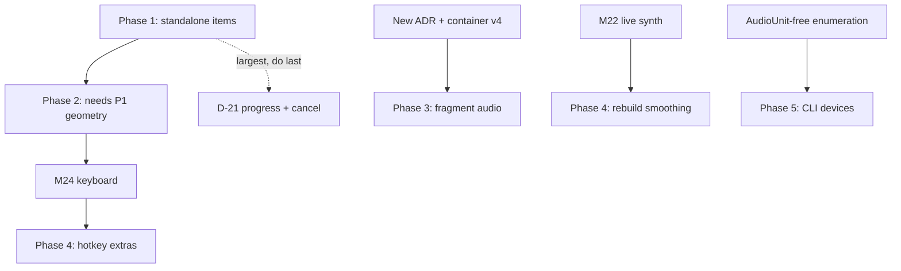

# Deferred work — ledger and delivery plan

This is the **single owner** of what Hey Listen has deliberately not shipped: one row per
item, with its blocker and the phase it belongs to. Area docs keep the *technical reason* a
thing is hard (the node model cannot express a `Sequencer`; a batch tool must not prompt);
they point here instead of keeping their own backlog list. When an item ships, **delete its
row** and mark it delivered in the owning milestone — a "done" table here would only rot.

Phases are an order, not a commitment: the roadmap rule still holds ("deliver one
milestone at a time; only start when asked"). Nothing below is started.

## States

| State | Meaning |
| --- | --- |
| `now` | Deliverable today: no decision, milestone, or platform work in the way. |
| `decision` | Waiting on an architecture decision (an ADR amendment or a new ADR). |
| `milestone` | Waiting on a planned milestone (M13, M22, M24). |
| `platform` | Waiting on work nobody has scheduled (AudioUnit-free device enumeration). |
| `backlog` | Kept, no target. Not refused; simply unscheduled. |
| `cancelled` | Closed as a non-goal. Reviving it needs a new ADR (see [ADR-35](decisions.md#adr-35--non-goals-for-the-1x-line)). |

## Ledger

### Phase 1 — deliverable now (`now`)

| ID | Item | Depends on | Plan |
| --- | --- | --- | --- |
| D-01 | Timeline hover crosshair + time/sample readout | — | Read the pointer through the same window↔pixel map the drag selection uses; show `mm:ss.mmm` + sample index in the move bar. `src/components/timeline/{interaction,draw}.ts`. |
| D-02 | Return-to-start transport action | — | Add `seek(0)` to the transport store + a toolbar action. The `Home` binding lands with M24, not here (see D-25). |
| D-03 | Follow-playhead toggle | — | Transport field; when on, scroll the view when the playhead leaves it. The `F` binding is M24's (D-25). |
| D-04 | Clamp a paused/idle playhead into a moved window | — | Stop leaves the line where it is; a window move must bring a paused line inside it. Core owns the position (ADR-22). |
| D-05 | Numeric window start/end/duration fields | — | Editable fields beside the window readout; clamp and commit through the existing window setter so every writer agrees. |
| D-06 | Wider window handles + move-bar hit targets | — | Constants in `timeline/constants.ts`; hit testing only. |
| D-07 | Shared pitch-range control | — | One control fanning out to `minF0Hz`/`maxF0Hz` on every pitch tool. No schema change (`analysis-metrics.md`). |
| D-08 | Shared calibration control | — | One knob fanning out `calibrationDbSpl` on the calibrated tools. No schema change (`analysis-psychoacoustics.md`). |
| D-09 | MCP configurable preview length | — | `PREVIEW_RECORDS` (`audio/analysis/shape.rs`) becomes a request field with bounds. |
| D-10 | "Did you mean?" for unknown tools/options | — | Unknown ids fail at the boundary today with a bare message; suggest the nearest catalog id. Cheap edit distance, no new dependency. |
| D-13 | Window history + previous/next annotation | — | Ring of committed windows + annotation ordering; expose as actions (bindings in M24). |
| D-15 | Reference-fragment timeline strip | — | Reuse the annotation lane strip for the pinned reference window on time charts. |
| D-16 | Per-node inspectors + presets | — | Graph-editor UI only; the node model already carries positional params. |
| D-17 | Remaining fundsp nodes | — | One `make_unit` arm + palette entry + `kind_arity` each; the palette already covers the filter, generator, dynamics, modulation, reverb, math and panning families. Grouped: extra shaping, delay-as-signal, envelope/gate. |
| D-18 | Per-note modulation option | M18 (delivered) | Let `modulation` run per note segment instead of over the whole window. |
| D-19 | MCP summary-aware annotation snapshots | — | The frozen values snapshot gains the tool's summary keys (`AnnotationValues`). |
| D-20 | `i16` `DATA` read + write | — | The container reserves the `format` byte; the reader currently rejects anything but f32. |
| D-21 | Analysis progress + mid-run cancellation | — | Largest Phase-1 item; `analysis.rs` is a plain `spawn_blocking` with no cancel token. Do it last and alone. |
| D-22 | MCP reuses the `RESULTS` cache | — | MCP/CLI runs recompute and the MCP save path writes `results: []`; read and write the cached entries. |

### Phase 2 — needs a Phase-1 foundation (`now`)

| ID | Item | Depends on | Plan |
| --- | --- | --- | --- |
| D-11 | Timeline context menu | D-01 | Needs the shared pointer→time/beat geometry and a menu primitive (none exists yet); ship the primitive as part of this. |
| D-12 | Snapping (playhead / annotations / window edges / zoom-dependent grid) | D-01, D-11 | Candidate geometry comes from D-01; the enable/disable surface comes from D-11. |
| D-14 | Accessibility: focusable canvas + ARIA announcements | D-01, D-02, D-13 | Announce window/playhead moves; ADR-19 is unaffected (selection still never reframes). |

### Phase 3 — decision-gated (`decision`)

| ID | Item | Depends on | Plan |
| --- | --- | --- | --- |
| D-23 | Fragment-audio re-gridding + re-link for saved references | A new ADR that reverses "result-only" + container v4 + a migration | ADR-24/27/34 make a saved comparison a **result snapshot**, so a saved reference is shown on its own grid. Storage, re-gridding and re-link are one change, not three. |

### Phase 4 — milestone-gated (`milestone`)

| ID | Item | Depends on | Plan |
| --- | --- | --- | --- |
| D-24 | Click-free smoothing across a net rebuild | M22 | ADR-21 defers a phase-continuous rebuild; `follow` smoothing only glides *within* a compiled net. |
| D-25 | Hotkey sub-items: chords, modifier-only bindings, per-project bindings, native menu accelerators, keymap import/export, preset keymaps, mouse gestures | M24 | `hotkeys.md` defines them; none can land before the registry exists. Also where the `Home` / `F` bindings from D-02/D-03 attach. |
| — | Templates, live synth, keyboard control (whole milestones) | M13, M22, M24 | Tracked in the roadmap and their own docs; not restated here. |

### Phase 5 — platform-gated (`platform`)

| ID | Item | Depends on | Plan |
| --- | --- | --- | --- |
| D-26 | CLI `devices` enumeration | AudioUnit-free device enumeration (unowned) | On macOS today, enumerating outputs prompts for microphone/audio-capture permission; a batch tool must never prompt. Same fix the app's picker needs. |

### Backlog — kept, unscheduled (`backlog`)

| ID | Item | Why it is not scheduled |
| --- | --- | --- |
| D-27 | Second loudness model (Zwicker / ISO 532-1, time-varying, Sottek) | M27 committed to one stationary model; the scales are structured for a second. Large, no blocker. |
| D-28 | Binaural ITD/ILD + a spaciousness model | The stereo analyzer is a point read by design (ADR-25); a width model is new DSP. |
| D-29 | FLAC-compressed `DATA` | Storage optimisation; the format has no FLAC slot yet. |
| D-30 | Rust-side peak/LOD streaming | Retires ADR-9's recorded deviation (the WebView keeps a full PCM copy). Needs a new streaming IPC, not a patch. |
| D-31 | Per-tool `outputSchema` | The result is an internally tagged union (ADR-2) and the protocol version is client-negotiated; needs a hand-written schema mirror. |
| D-32 | A structured-event contract for long runs | Needs a design; today progress is polled/streamed ad hoc. |
| D-33 | Fully stereo preview/analysis chain | M8.A delivered graph-level stereo inside a mono I/O net; a channel selection per analyzer is the delivered model. Independent stereo analysis is a new contract (and pairs with D-28). |
| D-34 | Synth extras: per-node solo/audition, parameter automation, MIDI, live *input* graphs | Outside M22's scope by decision (ADR-21 covers audition and in-place source only); each is a separate design, not a follow-up patch. |

## Cancelled

Not listed here on purpose: a refused item is not deferred. The list and its reasons are
in [ADR-35](decisions.md#adr-35--non-goals-for-the-1x-line); reviving one needs a new ADR.

## How phases relate

The arrow into M24 is the important one: **D-02, D-03 and D-13 ship the actions first**, so
M24 only has to bind keys to commands that already exist instead of designing them.

## Adding or closing an item

- New deferral: add a row with a stable `D-nn`, a state, and its dependency; link the
  owning doc/milestone. Do not add a second list to the area doc.
- Shipping: delete the row, and state the delivery in the owning milestone/doc.
- Refusing: add it to ADR-35 and delete the row here — a cancelled item is not "deferred".
