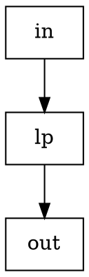

# Graph editor (fundsp)

The filter and synth graphs are built with `solid-flow` in two **Workbench tabs**
(see ADR-10). The frontend owns *editing*; the Rust core owns the *net* — a
`GraphSpec` (the stored form) is compiled to a fundsp `Net` in
`src-tauri/src/audio/graph/`. Its canonical text form is **DOT** (M39).

## Canvas gestures

- **Select** — click a node or a connector. Dragging on empty canvas draws a selection
  box over nodes *and* connectors; shift-click extends a selection. Panning is the
  middle/right mouse button, so a left drag never turns into a pan instead of a box.
  A connector's hit band is ~20 px wide, so it is selectable without pixel-hunting.
- **Connect** — drag from a source port to a target port; an occupied input or a cycle
  is refused with a warning.
- **Insert** — dropping a node (from the palette or an existing node) onto a connector
  splices it in (see *Drop to insert*).
- **Layout** — the toolbar's **Layout** button lays every node out left to right with
  `@dagrejs/dagre` (measured node boxes, 24 px separation, 72 px ranks) and then fits
  the canvas to the result.

## The model mirrors fundsp `Net`

Compilation is a literal **push + connect**:

1. `Net::new(inputs, channels)` — one global input for filter graphs, and one net
   output per declared channel (see *Output channels*).
2. `net.push(unit)` for every node.
3. `net.connect(src, src_port, dst, dst_port)` for every edge — **each input takes
   exactly one source**.
4. The `input` / `output` anchors are bridged to the net's global input/output.

There is **no implicit summing**: only what is wired to `Output` is the graph's
result. (The previous "sum every terminal node" behaviour was removed — it silently
mixed in dangling/unwired paths.)

## Output channels

`output` nodes each carry a **`Ch`** parameter, so a graph can produce more than one
channel — e.g. one input split into bands, each band wired to its own `Output`:

```
input [kind="input", label="in"]
low  [kind="lowpass", freq=400]
high [kind="highpass", freq=400]
out0 [kind="output", channel=0]
out1 [kind="output", channel=1]
in:out -> low -> out0:in
in:out -> high -> out1:in
```

- Channels are 0-based and **unique**; a duplicate is `DuplicateOutput` and one outside
  `0…15` is `OutputChannel`. A channel nobody claims is silent.
- **The analysis `channel` pick selects the output channel.** One picker serves both
  halves of conditioning: it mixes the source down to that channel (out of range falls
  back to the downmix) and then keeps that output of the filter graph — so a 2-channel
  source can still reach output 3. "Downmix" averages every output.
- A **synth** graph renders every output channel into the source: the render becomes an
  **interleaved** `SourceData` with that channel count (so the Timeline shows one lane per
  channel and the analysis `channel` picks a source channel as usual).
- The Filter graph tab shows an **Analyse** selector once the graph declares more than
  one channel; the Timeline's channel rail is the picker for everything else.

## Node palette

The palette is generated from the **one** Rust node catalog
(`src-tauri/src/audio/graph/nodes/`) — `cargo test` writes
`src/bindings/nodeCatalog.json`, which `lib/graph/palette.ts` imports. The catalog says
each kind's arity, port names, parameter specs, category, hint, and whether it is
filter-only (`input`) or synth-only (the generators); `kind_arity`, DOT, `list_nodes` and
the editor palette all read that one table. Categories are `NodeCategory`.

**Fixed-parameter nodes** read their cut-off/Q/gain from positional `params` (the
`*_hz` constructors), so they have a single audio input. **Control-input variants**
(`*_cv`) instead take the cut-off and/or Q from extra inputs fed by `dc`/`sine_lfo`:
their visible `inputs` and the core's `kind_arity` match the fundsp constructor's
arity (e.g. `lowpass_cv` is *audio, cutoff, Q*; `bell_cv` adds a *gain* input;
`resonator_cv` is *audio, center, bandwidth*). Input 0 is always the audio; later
inputs are control signals. `compressor`/`gate` are built from fundsp's primitives
(level follower + gain map) because fundsp ships neither. Filter graphs seed as
`Input → Output`; synth graphs seed as `Sine → Output`.

**Stereo nodes.** The net's global input is mono (filter: 1 in; synth: 0 in), but nodes
may be **stereo internally** (`1→2`, `2→2`, `2→1`) — wire `Input → split → stereo FX →
join → Output` and the graph still resolves to one channel. `reverb2_stereo` and
`reverb3_stereo` take their loop filter as a positional cutoff (`lowpole_hz`) and
`panner`'s pan is a control input (its second port).

**Wavetable nodes.** A kind may declare a **variadic table** (`NodeDef.table`,
`NodeTable`): rows appended after its named params, in row order. `wave_synth` is the
first — `freq` then `amp, phase` per partial, **any number of rows** — because fundsp's
`Wavetable::new` takes an amplitude and a phase per partial and no fixed count. Three
consequences, all one place each: the core reads the tail of `GraphNode.params`; DOT
packs the rows into one attribute (`harmonics="1,0,0.35,0.25"`), so the row count is
free; and the editor stores them on the node (`data.table`) and edits them in the node's
**Wavetable tab** (`wavetable:<parent>/<node>`), which also imports and exports one
`amp,phase` row per line. The node card shows the cycle the rows add up to.

**Math nodes.** `add`/`subtract`/`multiply`/`divide`/`min`/`max` are 2-in/1-out
signal arithmetic (A op B) — `multiply` doubles as a VCA/ring-mod when one input is
a control signal from `dc`/`sine_lfo`; `add` is the arithmetic twin of the routing
`mix`. `abs` rectifies and `invert` flips polarity (both 1-in/1-out). fundsp exposes
its binary math as combinators (`sum`/`product`/`-`) rather than fixed-arity units,
so these are small custom `AudioUnit`s in `audio/graph/` (as with `SumUnit` and the
compressor/gate).

**Parameter smoothing.** Control-rate inputs — every `*_cv` cut-off/Q/gain/… input
and `panner`'s pan — are wrapped in fundsp's one-pole `follow` smoother, so live
control signals (e.g. from `sine_lfo`) glide instead of stepping. (Full click-free
smoothing across a net *rebuild* is out of scope.)

## Rules (enforced in the UI *and* the core)

- **Exactly one `input`** (filter graphs). **One `output` per channel**: a filter graph
  may declare several (channels 0-based, unique and in range), a synth renders them as a
  multi-channel source.
- **One source per input** — a second edge into an occupied input is rejected
  (`GraphError::InputConflict`); the UI blocks it and warns.
- **No cycles** (`GraphError::Cycle`), no self-links.
- Unknown kinds are rejected (`GraphError::UnknownKind`).

## Application

- The **filter graph** is installed via `set_filter_graph` (debounced) and applied
  to the (channel-selected, mono) signal **before preview** and, from M4, analysis.
  The **Timeline toolbar's Filter switch** bypasses it. The fresh `Input → Output`
  seed is an identity pass-through, so the switch reads **off** until a non-anchor
  node is added; enabling it while the graph is still the seed opens the filter view
  so the user can compose one.
- The core filters a region **when it is loaded**, so `audio/preview.ts` re-issues
  the active preview whenever the filter graph, analysis channel, or output device
  changes — a filter edit is heard immediately, not on the next preview.
- The **synth graph** is rendered to PCM by `render_synth` (48 kHz mono) and becomes
  the project source.

### Live synth (M22)

- **Live** re-renders the synth **source in place** on each settled edit
  (`update_synth_source`, capped at 10 s), preserving the analysis window, timeline zoom,
  annotations, history and open analyzer tabs, so the waveform and analysis follow the
  graph. Playback is the Timeline's transport; the synth tab adds no second play control.
  **Render once** stays for long/one-shot renders, and shares the in-place path when the
  source is already the synth.
- The scheduler debounces ~160 ms and is latest-wins. A failed render keeps the last good
  source and reports inline.
- A compiled net is reused across settles, so a parameter-only edit patches the affected
  node instead of recompiling the graph; a structural edit rebuilds.
- See [`roadmap.md`](roadmap.md) → M22 and ADR-21.

## DOT interchange (M39)

The compilable graph has a canonical **text** form: Graphviz DOT (ADR-36). A node is a
statement with `kind` and **keyed** params; a node with more than one input or output is a
**record** whose `label` names each port, so an edge writes `src:out -> dst:cut`:



- Params resolve against the catalog: an unknown key, a value outside `min..max`, an
  unknown port, or a missing port on a multi-port node is an error; omitted keys take
  the default. `GraphSpec → DOT → GraphSpec` is identity.
- Parsing goes through `petgraph`'s `dot_parser` **AST** layer (the only layer where
  `node:port` survives). `GraphSpec` stays the stored form: the project file and
  `postcard` are unchanged and petgraph's `serde-1` is not used.
- **Discovery:** MCP `list_nodes` / `get_node` and the CLI `nodes [KIND]` report the same
  catalog; `get_node` returns a ready-to-paste DOT skeleton.
- **Boundaries:** `get_graph` reads a graph back as DOT; `set_filter_graph` and
  `render_synth` accept a DOT string or `graphFile`, and the CLI `synth <GRAPH>` /
  `--filter` accept DOT text, a `.dot`/`.gv` file or a legacy JSON file. A DOT string
  may open with comments (`//`, `/* … */`, `#` lines), as the committed fixtures do —
  the header keyword is looked for past them.
- **Shareable artifact:** each graph tab's toolbar **imports** a `.dot` file and
  **exports** the current graph (`graph_read_file` / `graph_write_dot`). Positions are a
  GUI-only concern: imported nodes land on a grid and **Layout** re-derives the real one.

### Nested subsystems (M40)

Some fundsp nodes are **combinators over an inner node** (`subgraph`, `feedback`,
`oversample`, `resample`). They are `subsystem` kinds: the node owns a nested
`GraphSpec` (`GraphNode.subgraph`), edited in its **own Workbench tab** instead of on the
parent canvas.

- **Opening** — a subsystem node's card shows a mini block-diagram preview and an
  **Open** button (`graph.subsystem.open`); the Sidebar's **Graphs** tab also lists every
  subsystem, nested ones included. A tab is `system:<parent>/<node>` (a nested one extends
  the path), so it never collides with the filter/synth tabs or another subsystem.
- **Editing** — the tab is the same `GraphEditor`, bound to the subsystem's store; the
  nested graph is mirrored back into the owning node on every edit, so the project file,
  DOT export, MCP and the core always see one `GraphSpec`.
- **Deleting** — deleting the node closes its tab and drops the stores beneath it; the
  deletion (and a project undo) restores both, because it rides the normal project
  snapshot.
- **Anchors** — a subsystem's inner graph has its own mono `input` → `output` (a
  generator-style `sine` seed for `resample`, whose inner graph takes no input).
- **DOT** — a subsystem node names its block (`system="fb.system"`) and the block is a
  real nested `subgraph`:

  ```dot
  digraph {
      fb [kind="feedback", system="fb.system"];
      subgraph "fb.system" {
          in   [kind="input"];
          echo [kind="delay", time=0.11];
          out  [kind="output"];
          in -> echo; echo -> out;
      }
  }
  ```

### Snoop

`snoop` is a pass-through with a **live envelope** on its node card: the compiler hands
fundsp's `SnoopBackend` frontend to a registry keyed by `scope/node`, and the node polls
`graph_snoop` while mounted. A filter's tap updates while preview/analysis runs a render;
a synth's after **Render** / **Live**. Nothing is polled while no snoop node is visible.

## Palette UX

- **Search** — a search box at the top of the palette filters the nodes by label or
  kind name.
- **Click or drag** — a palette button **click** drops the node onto a free spot on
  the canvas; **dragging** it drops it *where you release*, and onto a **connector**
  it splices the node in (see *Drop to insert* below). The drag is driven with
  **pointer events**, not HTML5 drag-and-drop: Tauri's native file-drop handler
  consumes every drag over the WebView on macOS (so an HTML5 `drop` never fires) and
  shows its file-drop overlay mid-drag — see `src/state/dragdrop.ts`.
- **Drag preview** (M22) — the drag shows a **ghost** of the node under the pointer, a
  translucent **drop preview** at the landing position, and a **splice preview**
  (highlighted connector + *Insert into link* badge) when it would split an edge.
  Outside the canvas or when the drop is invalid it reads as not-allowed. The preview and
  the real drop both resolve through `lib/graphDrop.ts` → `dropTarget`, so what is shown
  is what happens.
- **Anchors are undeletable** — `input` / `output` cannot be deleted
  (`deletable: false`, and the editor's `onDelete` skips them). They seed at the
  left / right edges but are **freely draggable**.
- **Collapsible** — the palette folds to a small header toggle to free canvas space.
- **Hints** — every node kind carries a short, plain-language `hint` (what it does,
  not fundsp jargon) shown as a tooltip on the palette button and the node itself.

## Port labels

Every node shows a **tiny label** beside each input/output handle, so a port's role
is readable at a glance. Multi-port nodes get semantic labels — `mix`/`add` are
*A*/*B*, `split`/`join` and the stereo nodes are *L*/*R*, the `*_cv` filters are
*audio*/*cut*/*Q* (plus *gain*/*morph*), `resonator_cv` is *center*/*bw*, and
`panner` is *audio*/*pan*. Single-port sides are *in*/*out* and a multi-port side with no
semantic name falls back to *in1*/*in2*/*out1*/*out2*. The names are the catalog's own
`inputPorts` / `outputPorts` (the same ones DOT writes), render outside the handle, and
are `pointer-events: none` so they never interfere with wiring.

## Canvas

- The **zoom controls** sit at the top-right and the **MiniMap** at the bottom-right —
  on both editors (filter *and* synth) — so neither overlaps the top-left palette.

## Drop to insert

Dropping a node **onto a connector** — either a fresh node dragged from the palette
or an existing node dropped onto an edge — **splits that edge and inserts the node**:
the old `source → target` edge is removed and replaced by `source → node` (input 0)
and `node → target` (output 0), preserving the original ports. The node is centred on
the cursor. Insertion only applies to nodes that have **both** an input and an output
(so anchors and pure generators are skipped) and only when both the node's input 0 and
output 0 are free and no cycle would result; otherwise the drop just places the node.
Edge proximity is a distance test against the sampled bezier path (the same control
points solid-flow draws), with a ~26-unit threshold (`lib/graphEdges.ts`).

## Node parameters

Every node card shows its own numeric parameters inline, so a value is edited where it
is read (drag-to-adjust or type; see `graphEditor/ParamField.tsx`). Right-clicking a node
opens a one-item context menu with **Reset node**, which restores every parameter of that
node to its kind's default. There is no separate inspector panel, so the canvas always
keeps its full width; anchors (`input` / `output`) have no parameters and no menu.

The parameter field is shared by every node card, so drag-to-adjust and typing behave
identically everywhere. A parameter's numeric input also keeps the platform's spinner
buttons working: a press in the spinner's gutter steps the value instead of starting the
drag gesture.

A parameter's `min..max` is **fundsp's own domain** where fundsp documents one (`fir3`'s
Nyquist gain is `0..1`, a bell/shelf gain is a positive amplitude, `allpole_delay` is a
positive delay in samples, a reverb room is 10–30 m, a morph is `-1..1`); where fundsp
bounds nothing, the range is a generous musical bound rather than a DSP limit — the `dc`
constant reaches ±20 000 so it can drive a frequency, Q or gain control input. The catalog
`nodes/*.rs` is the only place a range is written. `nodes/tests.rs` renders every kind once
at each parameter's `min` and `max`, so a range the compiler cannot actually take (a zero
gain through `sqrt`, a zero all-pass delay, a zero oscillator pitch) fails the suite
instead of the audio.

## Deferred

Also see [`deferred.md`](deferred.md): click-free rebuild smoothing is **D-24**. The extra
shaping, delay-as-signal and envelope/gate nodes are delivered (D-17), and M40 completed
the **fundsp coverage** pass below.

- **`Sequencer`** — it schedules timed `AudioUnit` events (`push`, fades, replay
  mode), which the positional-params node model cannot express; deferred to a future
  event/sequence editor.
- **Expander** — fundsp provides none (as with the compressor/gate it ships nothing);
  the `gate` node is the practical downward expander.
- **Still not offered, and why (M40).** `adsr_live` needs an explicit gate edge (the
  `sine_lfo` + `follow` pair covers the common case); `mls_bits` adds only a seed length
  (`mls` covers it); the dirty/feedback biquads (`dlowpass`/`flowpass`/`dbell`/`fbell`/…)
  duplicate `moog`/`allpass` with a waveshaper in the loop; `playwave`/`wave_synth`/
  `phase_synth` need a sample/wavetable payload, which the numeric-params model cannot
  carry; `resynth` and `resample_fir` are analysis-rate tools, not real-time voices;
  `timer`/`shared`/`var` are host-thread state rather than DSP; `monitor`/`meter` are
  superseded by `snoop`; `ring` is a real-time queue, not a node; and fundsp's structural
  plumbing (`Pipe`, `Stack`, `Binop`, `MultiPass`, `An`, `SettingListener`, …) is the net
  itself. `bus`/`branch`/`thru`/`fdn` remain expressible as a `subgraph`.
- **M40 delivered** (the previously missing families): `ramp`, `rossler`, `lorenz`,
  `tanh`/`atan`/`softsign`/`crush`/`soft_crush`, `fir3`, `convolve`, `tap_linear`,
  `snoop`, and the `subgraph`/`feedback`/`oversample`/`resample` subsystems.

## Planned

- **Click-free smoothing across net rebuilds** — the current `follow` smoothing
  glides control signals *within* a compiled net, but a structural edit still rebuilds
  and steps; cross-rebuild (crossfade) smoothing is a future item
  ([D-24](deferred.md)). M22's Live path patches a single node's parameters, not a
  filter/net rebuild.
