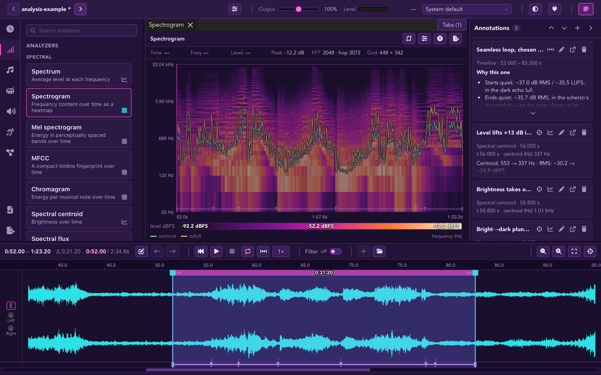

# 001 — The window at a glance

Hey Listen puts everything for one recording on one screen. The parts of that screen
never move, so you always know where things are.

## The fixed regions

- **Toolbar** (top). Project name, the analysis parameters, the filter switch, the MCP
  control, output gain and meter, the Annotations toggle, and the About button.
- **Activity bar** (left, narrow). Switches the Sidebar between the analyzer sections —
  *Time*, *Spectral*, *Pitch*, *Rhythm*, *Loudness* — and *Graph*, with **Sources** and
  **Export** pinned at the bottom.
- **Sidebar**. The content of the selected activity: searchable analyzer entries, the
  filter and synth graphs, the source controls, or the audio export.
- **Workbench** (centre). The largest area; everything you open lives here as tabs.
- **Annotations** (right). Your notes for this project; collapse it with the Toolbar
  toggle.
- **Timeline** (bottom). The waveform, the analysis window, and the transport. It stays
  visible from the start, with a placeholder until a source arrives.

## Tabs live only in the Workbench

Graph editors and analyzers are the only things that open as tabs, and they open inside
the Workbench. The other regions are not tabs and cannot be dragged into one. The source
controls and the audio export are **Sidebar views** chosen from the activity bar, not
separate regions. Reopen, reorder, split, join, or pop out a tab from its tab strip.

## Make room

Drag the dividers between regions to resize them. The bottom row keeps a sensible
minimum height, so you can never drag the Timeline away entirely.

> **Tip.** Want a bigger chart? Pop its tab out into its own window, or collapse the
> Annotations rail and the Sidebar.

Next: [Open a source](002_sources.md)
