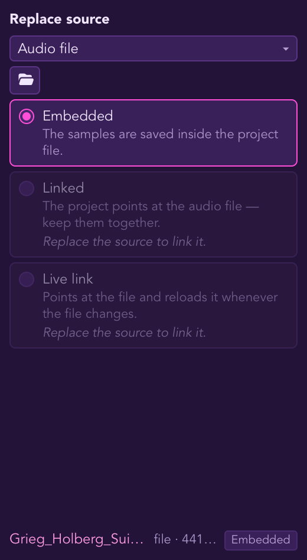
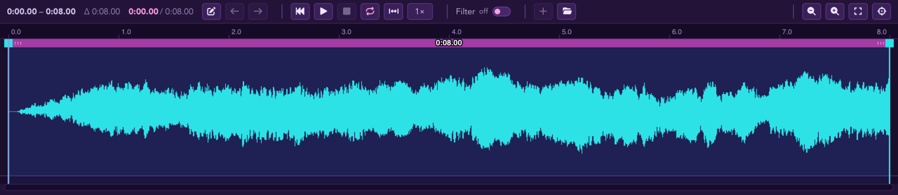

# 002 — Open, record, or synthesize a source

**In short.** A project has exactly one source, and everything you measure, filter, or
annotate belongs to it. Pick the source in the **Sources** rail: a file, a live input, or
a synth render.



## The simple path

1. Open **Sources** — the pinned tab at the bottom of the activity bar, or the
   **Replace source** button on the Timeline once a source exists.
2. Choose **Audio file**, then the folder button, and pick a recording.
3. Choose how the project should keep the audio (see below), then **Open**. Hey Listen
   decodes it and draws it on the Timeline.

The rail shows what is loaded: name, format, sample rate, channels, and how a save will
store it. Opening or recording a new source **replaces** the current one; if there is
unsaved work, the app asks first.

### Where the audio lives

| Choice | What it means |
| --- | --- |
| **Embedded** | The samples are written into the project file. The project travels alone. |
| **Linked** | The project points at the audio file. Keep the two together; in the same folder the path is stored relative. |
| **Live link** | Like linked, and the Timeline reloads whenever the file changes — so a re-export lands without reopening anything. |

Your last choice is remembered for the next file. A source already embedded can only
become linked by replacing it, because the audio in memory cannot vouch for a file on
disk. The rail says so rather than hiding the option.

A linked project whose file has gone missing still opens, with an empty Timeline and a
dialog to **locate the file** again. Saving a link that cannot be resolved offers to
embed the audio still in memory, instead of writing a project that could not reopen.

### Record a live source

Pick **Microphone**, **System audio**, **Application**, or **Mic + system**. Set the
device (or the application), the input **Gain**, and watch the **Level** meter. Then:

- **Start in** delays the recording; **Stop after** ends it automatically (`0` = until you
  stop).
- **Record** starts, **Pause** and **Resume** hold and continue, **Stop** ends the take.

What you captured becomes the source. While a capture is running, the Sources rail stays
open — its Stop lives there.

### Make a sound

Open the **Synth** graph in the Workbench and build the patch. Then, in Sources, choose
**Synth (graph)**:

- **Length** sets how many seconds to render (up to 60).
- **Render** creates the source, exactly as a recording would.
- **Live** re-renders in place as graph edits settle, so the analysis window, the
  annotations, and the open charts keep their positions. Live renders are capped at 10 s;
  use Render once for anything longer.



## Advanced — options and keys

- Switching storage is immediate for linked ↔ live link. A missing link is reported in
  the rail and at save time, never silently.
- A capture that fails to start shows the reason in the rail; the previous source is
  left alone.
- Opening a file from your operating system (double-click, or drag it onto the window)
  starts a **new project** with that file as its source; a dragged `.heyl` opens as a
  project instead.
- There is no source shortcut. Replacing the source starts a fresh undo history (see
  [Projects and export](009_projects.md)).

## With an agent

All of these are app-and-headless unless noted:

```text
open_audio_file { path, storage: "embedded" | "linked" | "liveLink", replace: true }
render_synth    { graph: "digraph { … }", seconds: 8, replace: true }
set_synth_graph { graph }                    # app only: fills the synth editor
start_capture   { kind: "mic" | "system" | "process" | "mix", deviceId, gain }
stop_capture    { }
list_input_devices { }   list_processes { }   list_output_devices { }
close_source    { }                          # clears the timeline
```

`get_state` reports the loaded source's shape, so an agent can check that the audio it
thinks it opened is the audio that is there.

## From the command line

The CLI renders a synth graph and can build a project from either kind of source:

```sh
# Render a DOT synth graph for 8 s and analyze the result
hey-listen-cli synth pad.dot --seconds 8 -t spectrum --summary

# Build a .heyl from an audio file, linking (not embedding) the audio
hey-listen-cli project song.heyl --source music.wav --storage linked --name "Song"

# …or from a synth graph
hey-listen-cli project pad.heyl --synth pad.dot --seconds 8 --open-tool spectrogram
```

Live capture needs a window, a device, and a person, so the CLI does not record.

Next: [Frame the question on the Timeline](003_timeline.md)
