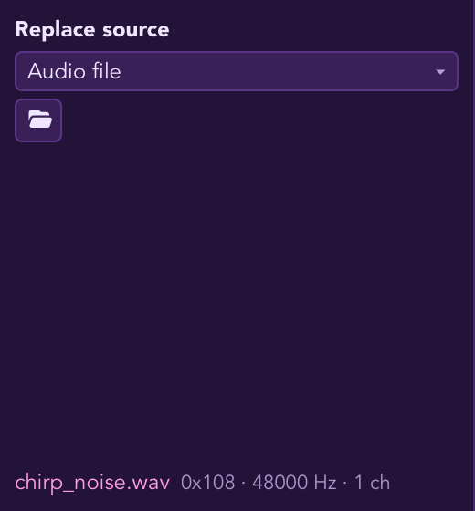
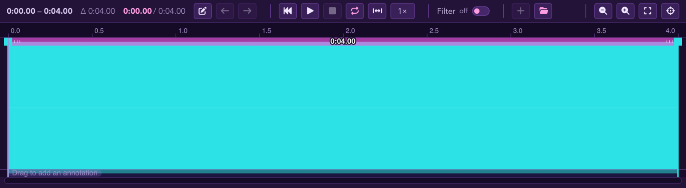

# 002 — Open or record a source

A project has exactly one source. Everything you analyze, filter, or annotate belongs to
that source, and changing the source replaces the whole timeline.

## Open a file

Use **Open audio file** in the Source panel, drag a file onto the window, or open a
recording straight from your operating system. Hey Listen decodes it and draws it on the
Timeline.

## Record a live source

Choose what to capture — a **microphone**, **system** output, a **selected process**, or
a **microphone-and-system mix** — set the input and gain, and monitor before you record.
You can pause and resume, and stop when you are done; what you captured becomes the
project's source.

## Make a sound

Build a synth graph and render it. The rendered audio becomes the source, exactly like a
recording would.

## Replace the source

Opening or recording a new source replaces the current one. If the project has unsaved
work, Hey Listen asks before discarding it. You cannot keep two sources in one project —
that is what a second project window is for (see [Projects](009_projects.md)).

## When something goes wrong

A file that cannot be decoded shows an error in the Toolbar and leaves the Timeline
empty, rather than opening silence. A capture that fails to start says so in the Source
panel.

Next: [Navigate the timeline](003_timeline.md)
