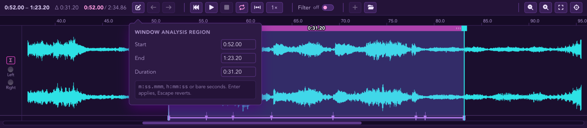
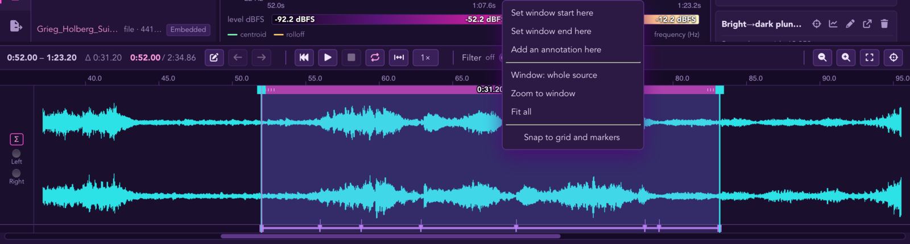

# 003 — Frame the question on the Timeline

**In short.** The Timeline holds the whole recording. The **analysis window** is the part
of it every analyzer measures, so this is where a vague question ("where does it change?")
becomes a specific one ("what happens between 52.0 and 83.2 seconds?").


## Set the analysis window

1. Drag across the waveform to select a new analysis window, the way you select text.
2. Drag either edge to adjust it.
3. Or type exact numbers: the pencil button beside the readout opens *Start*, *End*, and
   *Duration*. The arrows next to it step back and forward through recent windows.
4. Re-run what you have open — moving the window re-runs every open analyzer on the new
   region. Charts re-fit to it instead of showing a stale view.
5. **Zoom to the window** frames the selection; **Fit the whole source** shows everything.



Those last two are different tools: one changes what you *see*, the other changes what you
*measure*. The readout above the waveform always states both the window and the source
duration, so the two never get confused.

## Read the lanes

On multichannel audio each channel gets its own lane, with a rail that picks the lane you
listen to and analyze, plus a mono downmix. The selected lane stands out.

A filter graph can produce several output channels (one `Output` node each). While the
filter is applied, the source lanes stay as background and each output is drawn over them
in the filtered colour, one lane row per output — `Output 1`, `Output 2`, … in the rail.
Every branch is visible, analyzable, and playable side by side. Which *source* channel the
graph reads is the graph's own business, set by its `Input` node's `Ch` (`-1` downmixes).

## Advanced — the menu, snapping, and zoom

Right-click the waveform for the quick actions: *Set window start here*, *Set window end
here*, *Add an annotation here*, *Window: whole source*, *Zoom to window*, *Fit all*, and
*Snap to grid and markers*.



**Snapping** is off by default. Turn it on when a handle should land on the ruler grid or
a marker rather than under your pointer; turn it off when you want the exact frame you
dragged to.

**Zoom and scroll.** Scroll over the waveform to zoom, and use the bar along the bottom to
pan while zoomed in. Zoom and the analysis window are independent — zoom never re-runs a
tool.

| Key | Does |
| --- | --- |
| `←` / `→` | Move the playhead (1% of the visible span); `Shift` for ten steps |
| `Alt+←` / `Alt+→` | Move the playhead by one sample frame |
| `Home` / `End` | Playhead to the source start / end |
| `[` / `]` | Set the window start / end at the playhead |
| `PageUp` / `PageDown` | Previous / next analysis window |
| `Z` | Zoom the view to the analysis window |
| `0` | Fit the whole source |
| `=` / `-` | Zoom in / out |

The Timeline announces what a keyboard move did — the time and the window — so you can
frame a window without watching the numbers. Play and loop keys are in
[Listen, and drive by keyboard](008_preview.md).

## With an agent

The window is an argument on every call, so an agent frames the question explicitly:

```text
set_analysis_window { start: 52.0, end: 83.2 }
run_analysis { tool: "spectralCentroid", summaryOnly: true }
set_view { start: 40, end: 95 }        # what is visible, not what is measured
```

`run_analysis` also accepts `start`/`end` for one call. By default those are written back
to the project (so the window on screen follows); pass `transient: true` to measure a
region without changing the project's window. `get_state.window` reports the current one.

## From the command line

Windows are the CLI's unit of work. One span, or a list of them:

```sh
hey-listen-cli analyze song.heyl -t loudnessIntegrated --start 52 --end 83.2 --summary
hey-listen-cli analyze song.heyl -t frameRms --windows windows.txt --out results/
```

A window file is one `start,end[,tool,tool…]` per line, with `#` comments, so a batch can
measure every candidate span in one run. `compare` has the same idea per side
(`--a-start`, `--b-start`, …) plus `--overlap`, which clips both sides to their
absolute-time intersection.

Next: [Shape the sound](004_graphs.md)
