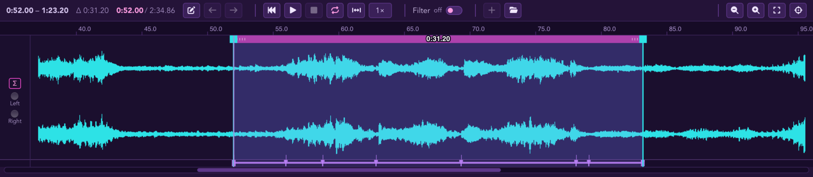

# 003 — Navigate the timeline

The Timeline shows the record you are working on. The **analysis window** is the part of
it the analyzers measure; the rest of the record is context.

## Frame the question

- Drag across the waveform to select a new analysis window, the way you select text.
- Drag the window's edges to adjust it.
- Use the window fields (*Start*, *End*, *Duration*) to type an exact window, and the
  arrows beside them to step back and forward through recent windows.
- **Zoom to the window** frames the current selection; **Fit the whole source** shows
  everything.

Those two are different tools: one changes what you see, the other changes what you
measure. Moving the analysis window re-runs the open analyzers on the new region.

## Zoom and scroll

Scroll over the waveform to zoom, and use the scrollbar along the bottom to pan while
you are zoomed in. Charts that are open re-fit themselves to the new window instead of
showing a stale view.

## Channels

On multichannel audio each channel gets its own lane, with a rail to pick the channel
you are inspecting or analyzing, including a mono downmix. The selected lane stands out.

## Right-click

Right-click the waveform for the quick actions: set the window start or end here, select
the whole source, or add an annotation. Snap can be turned on to keep edits aligned to
features you can see.

## Keyboard

The Timeline announces what a keyboard move does, so you can frame a window without
looking at the numbers. See [Preview and keyboard](008_preview.md).

Next: [Filter and synthesize](004_graphs.md)
