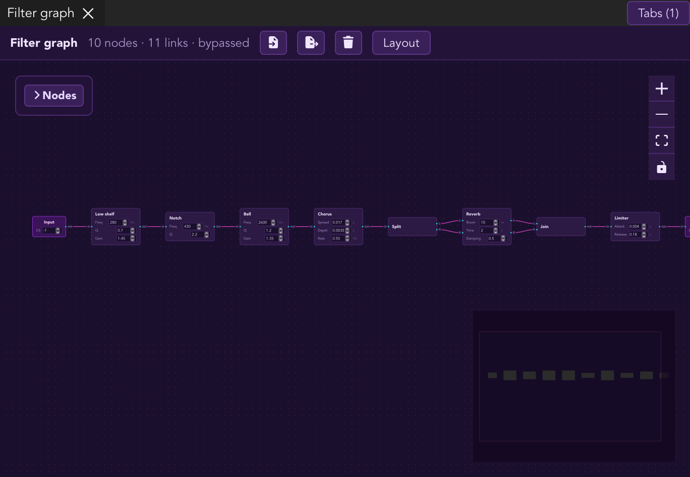
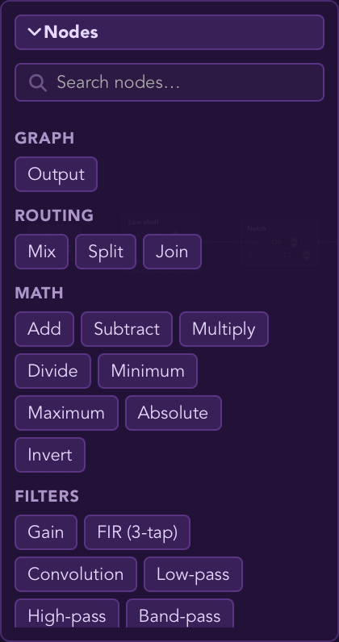

# 004 — Shape the sound

**In short.** Two graph editors change the audio: **Filter** processes the source before
any analyzer sees it, and **Synth** generates a source of its own. Both are built from the
same nodes and share the same text format.



## Build a chain

1. Open **Graphs** in the activity bar and pick **Filter** or **Synth**.
2. Add a node: search the palette, then click it, or drag it onto the canvas. Dropping a
   node **on a wire** inserts it between the two nodes.
3. Wire nodes by dragging from one labelled port to another. Incompatible ports are
   refused rather than connected.
4. Adjust a node's parameters on its card. Its context menu resets the node.
5. Press **Layout** if the graph has drifted; the canvas fits itself to the result.



To hear and measure the filtered signal, switch **Filter** on in the Timeline toolbar.
While it is applied, every analyzer, the preview, and the waveform read the processed
signal; comparing the two waveforms is how you check what the graph did.

For a synth, the graph is only the recipe: open **Sources**, choose **Synth (graph)**, set
**Length**, and press **Render**. See [Open, record, or synthesize a source](002_sources.md).

## Nest a subsystem

A graph can nest another graph. The nested node shows a thumbnail; open it in its own tab
to edit it, and the parent updates as you do. Use a subsystem when one chain belongs
inside another — a reverb send, a drum voice, a shared tone stage — instead of copying its
nodes into every patch.


## Advanced — outputs, tables, and DOT

- **Several outputs.** Wire each branch to its own `Output` node. Every output is its own
  channel, drawn as its own lane, so one filter can show, say, three bands side by side.
  The graph's `Input` nodes choose the *source* channel each branch reads.
- **Snoop.** Add a `snoop` node to tap a signal and watch its level live while you adjust
  the graph.
- **Tables.** Table nodes (wavetables, note sequences) carry their rows with the graph and
  are edited or imported in their own tab.
- **Its own window.** Right-click the graph tab and choose **Pop out to window** to edit a
  large canvas beside the Workbench. It is the same graph in both places.
- **Text as the format.** **Export** writes a DOT file; **Import** reads one back. The
  same text drives the CLI and an agent, so a patch can leave the app and return
  unchanged — including nested systems and the tables inside them.

| Key | Does |
| --- | --- |
| `Cmd/Ctrl+Enter` | Render the synth, from a graph tab |

Undo and redo apply to a graph edit with the rest of the project; see [Keep, undo, and
take the data out](009_projects.md).

## With an agent

```text
get_graph         { graph: "filter" }          # canonical DOT, plus the editor layout
set_filter_graph  { graph: "digraph { … }", enabled: true }
get_graph         { graph: "synth" }
set_synth_graph   { graph }                     # app only
render_synth      { graph, seconds: 8 }         # render and adopt as the source
list_nodes        { }                           # kinds, ports, parameter ranges
get_node          { kind: "reverb" }            # a DOT skeleton at default values
```

A DOT string is the canonical form in both directions: read a graph, edit the text, send
it back. `list_nodes` and `get_node` come from the same table the parser and the editor
read, so a port name an agent sees is a port name the app accepts.

## From the command line

```sh
hey-listen-cli nodes                        # every node kind
hey-listen-cli nodes reverb                 # its params and a ready DOT skeleton
hey-listen-cli synth pad.dot --seconds 8    # render a synth graph
hey-listen-cli analyze song.wav --filter chain.dot -t spectrum --summary
hey-listen-cli project out.heyl --source song.wav --filter chain.dot
```

`--filter` on `analyze` and `synth` applies a graph for that run; on `project` it is saved
into the file, along with its applied/bypassed state.

Next: [Measure what the window contains](005_analyzers.md)
