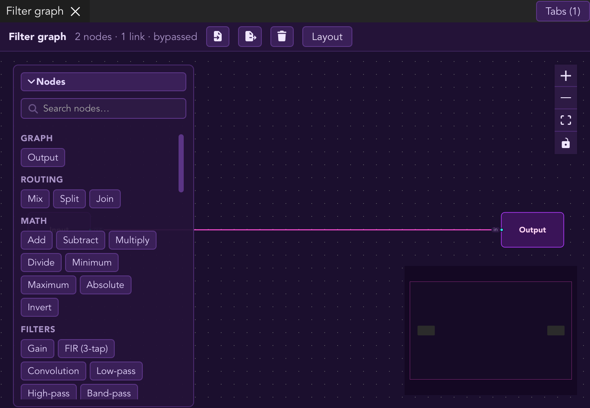
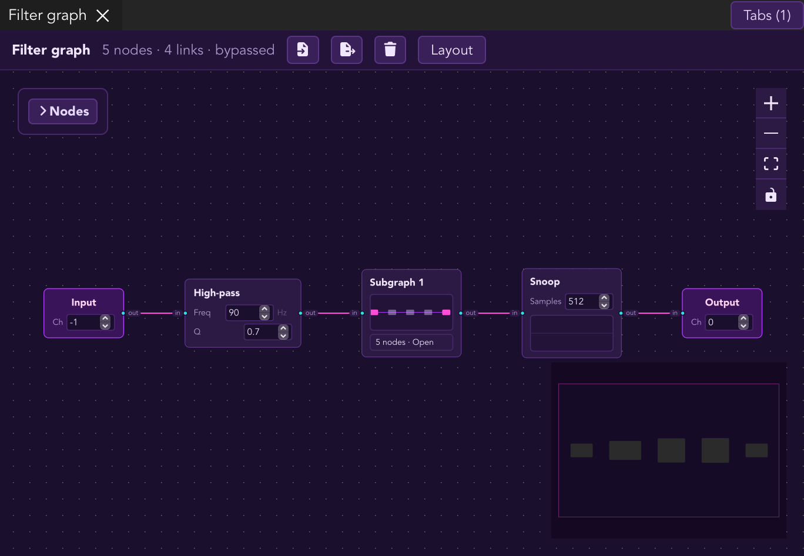

# 004 — Filter and synthesize

Two graph editors shape sound. **Filter** processes the source before any analyzer sees
it; **Synth** generates a source of its own.

## Build a graph

Open **Graph** in the activity bar and choose a graph. In the editor:

- Search the palette and click to place a node, or drag one onto the canvas.
- Drop a node onto a wire to insert it between two nodes.
- Wire nodes by dragging from one labeled port to another.
- Adjust a node's parameters right on its card; reset it from its context menu.
- Zoom, and use the minimap to move around a large graph.

Nodes cover generators, routing, math, filters, dynamics, modulation, reverb, and
control. A graph can nest a subsystem and tap a signal with a snoop to watch it live.

## Filtering what you measure

The Toolbar's filter switch shows whether the graph is **applied** or **bypassed**.
While applied, every analyzer, the preview, and the waveform measure the filtered
signal. Compare the processed waveform with the original to see what changed.

For several parallel results, wire each branch to its own `Output` node: every output is
its own channel, so the Timeline keeps the source lanes in the background and draws one
filtered lane per output over them; the channel rail selects among the lanes (each new
`Output` takes the next free channel).

The `Input` node has a `Ch` too: it names the **source** channel the graph reads, and `-1`
(the default) downmixes the source to mono. Add a second `Input` to read another source
channel — each new one takes the next free channel — so a stereo source can run one branch
per side. The rail's pick is the **output** channel; the graph's `Input` nodes are what it
hears.

## Making a synth source

In the synth editor, set the **Length**, build the patch, and **Render**. The result
becomes the project's source.

Turn on **Live** and each settled edit, or a Length change, updates the source in place —
so your analysis window, annotations, and open charts keep their positions while you
tweak the sound.

## A graph in its own window

Right-click a graph tab and choose **Pop out to window** to edit it in a window of its
own — handy when you want the canvas large beside the Workbench. It is still the same
graph: an edit made in either window is the other's, and the filter it feeds stays
applied. A nested subsystem can be popped out the same way, from its own tab, or from
the node's open action while its parent graph is already popped out.

## Share a graph

**Export graph** writes the graph as a DOT file, and **Import graph** reads one back.
The same format works through the command-line tool and an agent, so a patch can leave
the app and return unchanged.

Next: [Analyze the sound](005_analyzers.md)
