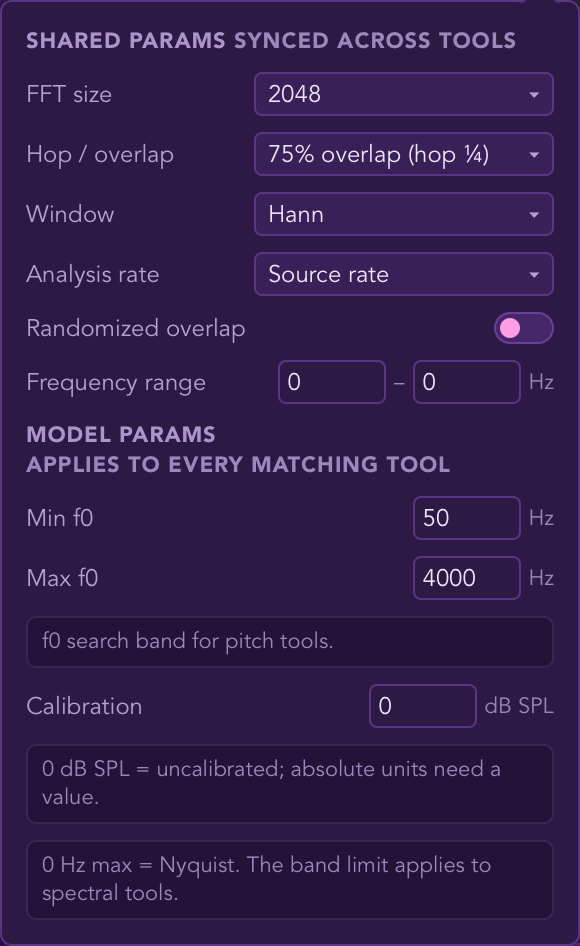

# 005 — Measure what the window contains

**In short.** Analyzers turn the analysis window into numbers you can read, compare, and
argue with. They all measure the same window with the same shared parameters, so two
charts never disagree about what "the signal" is.


## Choose a tool by the question

Start from what you want to know, not from the list. Every tool is in `list_analyzers`
and in the Sidebar; this table is the shortest path between a question and a tool.

| Question | Open |
| --- | --- |
| Where does it get loud or quiet? | *Waveform*, *Levels*, *Frame RMS* (Time domain) |
| Which frequencies are present? | *Spectrum*, *Spectrogram* (Spectral) |
| How is the energy spread? | *Mel spectrogram*, *Chromagram*, *MFCC* (Spectral) |
| How bright or dull is it? | *Spectral centroid*, *rolloff*, *bandwidth*, *crest* (Spectral) |
| Is it tonal or noisy? | *Spectral flatness*, *harmonic ratio*, *zero-crossing rate*, *tonality* |
| Where does the spectrum change? | *Spectral flux*, *Spectral entropy* |
| What pitch, and when? | *Pitch (pYIN / YIN / autocorrelation)*, *Note segments* (Pitch / melody) |
| How fast, and where are the hits? | *Tempo*, *Onsets*, *Downbeats* (Rhythm / tempo) |
| How loud in absolute terms? | *Integrated LUFS*, *Loudness range*, *Loudness (momentary)* |
| How loud does it *sound*? | *Loudness (sone/phon)*, *Sharpness*, *Roughness*, *Fluctuation strength*, *Masking* (Perception) |
| Is the level or the pitch wobbling? | *AM/FM modulation* (Spectral) |

1. Pick the section in the activity bar, or search the Sidebar by name or keyword —
   "brightness" finds *Spectral centroid*.
2. Click the tool. It becomes a Workbench tab; opening it again focuses that tab instead
   of making a second one.
3. Read the line under the chart title first: it states the peak, the settings actually
   used, and the frame count. If those settings are not what you expected, the chart is
   not answering the question you asked.
4. Hover the chart for values at a point. Right-click it to set the window start or end
   there, or to add an annotation.

## Read the result

Every tool has an **About** popover: what it measures, how to read it, and where its
limits are. Read it before trusting a number, especially for the perceptual tools.


*Readouts* (integrated loudness, loudness range) are single numbers. *Charts* (spectra,
spectrograms, pitch tracks, modulation) are axes you can inspect. *Tables*, such as the
detected note segments, pair every row with a time and a level. Some charts add a
drill-down card for the point under the pointer.

## Advanced — two levels of settings

**Shared** (Toolbar → the sliders icon): **FFT size**, **Hop / overlap**, **Window**,
**Analysis rate**, **Randomized overlap**, **Frequency range**, plus the model parameters
— the pitch search band and the calibration level. Editing one re-runs every open tool,
because they describe the same signal.



**Per tool** (the **Params** button on the tab): options that belong to one measurement,
such as a gate in dB or a YIN threshold. They never touch another tool.

**While it runs.** A slow tool keeps its tab, shows progress, and can be **Cancel**led. A
run replaced by a newer window is discarded instead of finishing quietly and drawing the
wrong answer.

**Perceptual tools need calibration.** Loudness, sharpness, roughness, fluctuation
strength, tonality, and masking report near zero while `calibrationDbSpl` is 0, because
absolute units need a reference. Treat the models as guidance: they are calibrated
against a reference signal, not against your recording's true sound pressure.

## With an agent

An agent gets the same catalog and the same results, in three levels of detail. Start
cheap, escalate only when the summary is not enough:

```text
list_analyzers { }                                   # ids, sections, result families
get_analyzer   { id: "pitchYin" }                    # options, ranges, summary keys
run_analysis   { tool: "pitchYin", summaryOnly: true }        # one line + labelled items
run_analysis   { tool: "noteMetrics" }                        # compact: stats + spans
run_analysis   { tool: "spectrum", includeData: true, maxPoints: 256 }
```

- `display: false` computes without opening a tab; `transient: true` means the call's
  window, params, and options do not change the project.
- `channels: [0, 1]` runs the same tool once per output channel, which is how to compare
  a multi-output filter's bands in one call.
- `noteMetrics.bounds` gives every detected note span even in the compact reply, so
  segmenting does not need the full arrays.

## From the command line

One analyzer over one window, or one tool over many windows:

```sh
hey-listen-cli analyze song.heyl -t spectrum --summary
hey-listen-cli analyze song.heyl -t noteMetrics --start 52 --end 83.2 --format csv --out notes/
hey-listen-cli analyzers                      # ids, sections, descriptions
```

The envelope is the same one MCP returns: effective window and settings, a canonical
summary, and the result. `--format json` writes the self-describing form; `--format csv`
writes a wide matrix plus its provenance sidecar.

Next: [Keep what you find](006_annotations.md)
