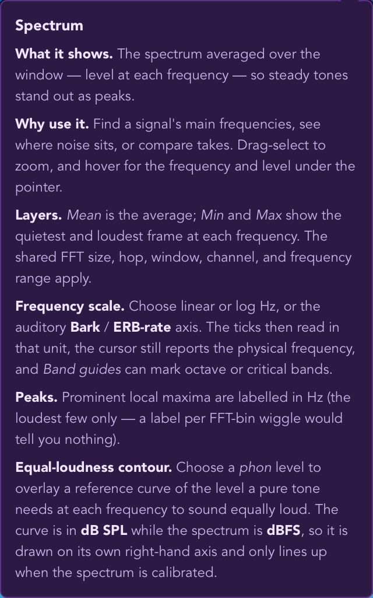

# 005 — Measure what the window contains

**In short.** Analyzers are the tools that turn the analysis window into numbers you can
read, compare, and argue with. They all measure the same window with the same shared
parameters, so two charts never disagree about what "the signal" is.


## The simple path

1. Pick a section in the activity bar: *Time domain*, *Spectral*, *Pitch / melody*,
   *Rhythm / tempo*, *Loudness*, or *Perception*.
2. Search the Sidebar by name or keyword — "brightness" finds *Spectral centroid* — and
   open a tool. It becomes a Workbench tab; opening it again focuses that tab instead of
   making a second one.
3. Read the line under the chart title first: it states the peak, the settings actually
   used, and the frame count. If those settings are not what you expected, the chart is
   not answering the question you asked.
4. Hover the chart for values at a point. Right-click it to set the window start or end
   there, or to add an annotation.



Every tool has an **About** popover: what it measures, how to read it, and where its
limits are. Read it before trusting a number, especially for the perceptual tools.

## Advanced — options and keys

**Two levels of settings.**

- *Shared* (Toolbar → the sliders icon): **FFT size**, **Hop / overlap**, **Window**,
  **Analysis rate**, **Randomized overlap**, **Frequency range**, plus the model
  parameters — the pitch search band and the calibration level. Editing one re-runs
  every open tool, because they describe the same signal.
- *Per tool* (the **Params** button on the tab): options that belong to one measurement,
  such as a gate in dB or a YIN threshold. They never touch another tool.

**What a result can be.** *Readouts* (integrated loudness, loudness range), *charts*
(spectra, spectrograms, pitch tracks, modulation), and *tables* (for example the detected
note segments with their durations and levels). Some charts also carry a drill-down card
for the point under the pointer.

**While it runs.** A slow tool keeps its tab, shows progress, and can be **Cancel**led. A
run replaced by a newer window is discarded instead of finishing quietly and drawing the
wrong answer.

**Perceptual tools need calibration.** Loudness, sharpness, roughness, fluctuation
strength, tonality, and masking report near zero while `calibrationDbSpl` is 0, because
absolute units need a reference. Treat the models as guidance: they are calibrated
against a reference signal, not against your recording's true sound pressure.

| Key | Does |
| --- | --- |
| `Cmd/Ctrl+Shift+F` | Focus the Sidebar search |
| `Cmd/Ctrl+K` | Palette: type a tool name to open it |
| `Ctrl+Tab` / `Cmd/Ctrl+1…9` | Move between open tabs |

## With an agent

An agent gets the same catalog and the same results, in three levels of detail. Start
cheap, escalate only when the summary is not enough:

```text
list_analyzers { }                                   # ids, sections, result families
get_analyzer   { id: "pitchYin" }                    # options, ranges, summary keys
run_analysis   { tool: "pitchYin", summaryOnly: true }        # one line + labelled items
run_analysis   { tool: "noteMetrics" }                        # compact: stats + spans
run_analysis   { tool: "spectrum", includeData: true, maxPoints: 256 }
```

- `display: false` computes without opening a tab; `transient: true` means the call's
  window, params, and options do not change the project.
- `maxPoints` thins series and matrices; it never removes events or note segments.
- `set_shared_params` and `set_tool_options` change the setup for later calls.

## From the command line

```sh
hey-listen-cli analyzers                         # the catalog
hey-listen-cli analyzers pitchYin                # that tool's options and defaults
hey-listen-cli analyze song.wav -t spectrum -t pitchYin --summary
hey-listen-cli analyze song.wav --all --full --out analysis/
hey-listen-cli analyze song.wav -t spectrum --csv --out spectrum.csv
```

Every result carries its own provenance: which tool ran, on which window, with which
parameters and options. `--summary` is the short answer, `--full` the raw arrays, and the
default in between is the structural form (dimensions, peaks, bounded previews). A JSON
result is a self-describing envelope; CSV is a wide matrix with a metadata sidecar.

Next: [Keep what you find](006_annotations.md)
