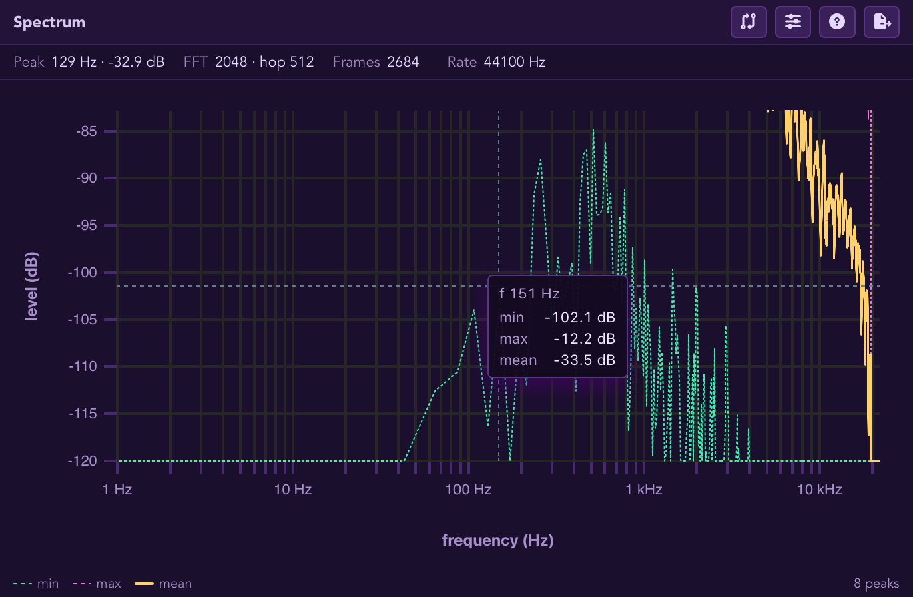

# 005 — Analyze the sound

Analyzers are the tools that tell you what is happening in the analysis window.

## Find a tool

Pick an activity section in the bar — *Time*, *Spectral*, *Pitch*, *Rhythm*, or
*Loudness* — and search the Sidebar by name or keyword. Open a tool and it becomes a
Workbench tab. Opening the same tool again focuses its existing tab instead of creating a
duplicate.

Every tool has an **About** popover that explains what it measures and how to read it.
Read it before trusting a number.

## Shared parameters, per-tool options

The parameters in the Toolbar — FFT size, overlap, window function, channel, resampling,
and frequency range — are shared across tools, so two charts describe the same thing.
Each tool's own options sit behind its **Params** button and affect only that tool.

## Reading a chart

Move the pointer over a chart to read its values at a point. Time-based charts share the
playhead, so previewing shows where you are in every chart at once. A tool that is slow
keeps its tab open, shows its progress, and can be **Cancel**led; a run replaced by a
newer window is discarded rather than finishing quietly.

## The kinds of answer

- **Readouts** — levels, integrated loudness, and loudness range as cards.
- **Charts** — spectra, spectrograms, pitch tracks, modulation, and more.
- **Tables** — for example the detected note segments, with their durations and levels.

For psychoacoustic views — critical bands, loudness, sharpness, roughness, masking,
tonality, and spatial cues — treat the models as guidance and calibration-dependent.

Next: [Annotate what you find](006_annotations.md)
