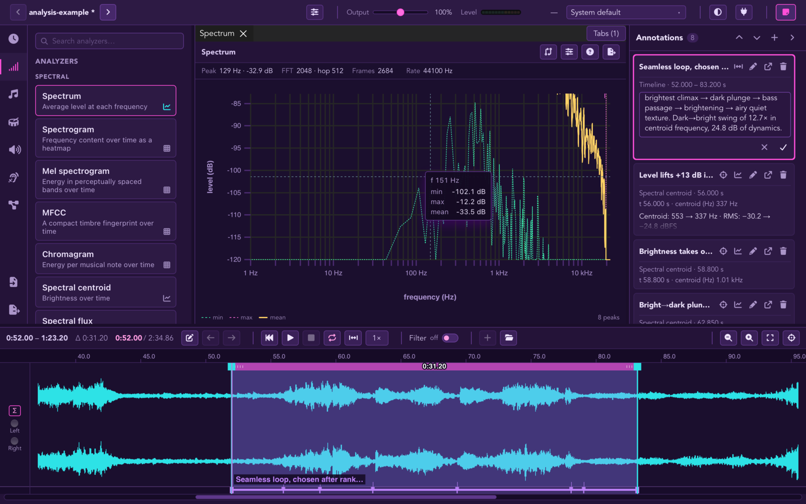

# 006 — Keep what you find

**In short.** An **annotation** is your note, attached to a moment or a span. It keeps
what you saw — the numbers and settings — so a later change to the analysis cannot rewrite
your evidence. The detected notes in a pitch or melody result are **note segments**, not
annotations; those are the analyzer's output, not your writing.


## Mark a moment

1. Add one: the **+** in the Annotations rail, **Add an annotation here** on the Timeline
   right-click, the **+** on the Timeline toolbar (at the playhead), or the same command
   on a chart's right-click.
2. Write it in Markdown. The **first line becomes the title**, so the rail stays scannable.
3. Press **Save** (or `Cmd/Ctrl+Enter`). Writing a note never moves the window or the
   playhead; you are recording what you see, not changing it.
4. Click an annotation's title to **select** it. It is highlighted in the rail, on the
   Timeline's annotation lane, and on every time-based chart, so one moment is findable
   everywhere.



Each card carries what the note is attached to: the tool (or *Timeline*) and the time or
span. An annotation with a range can be analyzed as a window in one click.

## Advanced — frozen values, ranges, and the trail

- **Frozen values.** A chart annotation stores the reading and the settings that produced
  it. Change the FFT or re-run later and the card keeps your snapshot; when the live value
  differs, it is shown struck through beside the frozen one, so drift is visible instead
  of silent.
- **Ranges.** Drag across the Timeline's annotation lane, or a chart's lane, to mark a
  span. Its edges are draggable; **Analyze** then uses that span as the window.
- **Analyze** moves the analysis window onto the annotation when you decide to; browsing
  the rail never re-frames the analysis.
- **Open the chart** focuses the tool the annotation came from.
- **Open in its own window** keeps a long note beside the charts while you edit.
- **Next** / **Previous** step through the notes in time order.
- Collapse the rail and the Toolbar keeps a count; **Delete** removes the note everywhere
  at once.

| Key | Does |
| --- | --- |
| `N` | Add an annotation at the playhead |
| `Cmd/Ctrl+Shift+A` | Show or hide the Annotations rail |
| `Cmd/Ctrl+Enter` | Analyze the selected annotation |
| `E` | Edit the selected annotation |
| `Cmd/Ctrl+Backspace` | Delete the selected annotation |

## With an agent

Annotations are the part of a project an agent should treat as **the user's**, so they are
written as records, not as chat:

```text
create_annotation { time: 58.8, tool: "spectralCentroid", title: "Brightest point",
                    body: "Centroid 549 → 1015 Hz within 0.1 s.", range: { startSecs: 58.5, endSecs: 59.5 } }
list_annotations  { }
update_annotation { id, body, recomputeValues: true }
set_selected_annotation { id }
delete_annotation { id }
```

On the bridge, a new annotation snapshots the live chart when that chart is open.
Headless, `save_project` writes the annotations you pass, which is how a script leaves a
project with its findings attached.

`create_annotation`, `update_annotation`, `delete_annotation`, and
`set_selected_annotation` are app-only; reading (`list_annotations`, `get_annotation`) and
writing whole projects work headless.

## From the command line

```sh
hey-listen-cli annotations song.heyl --json --full
hey-listen-cli annotations song.heyl --get 18c589d6-…
hey-listen-cli annotations song.heyl --add notes.json
hey-listen-cli annotations song.heyl --update 18c589d6-… --set "title=Brightest point"
hey-listen-cli annotations song.heyl --delete 18c589d6-… --to copy.heyl
```

`--add` takes a JSON array of annotation objects — the same shape `--json` prints — and
`--to` writes a changed copy instead of editing in place, which is the safe habit in a
script. An annotation's frozen values travel with it, so a note made in the app stays
readable from the file alone.

Next: [Compare two projects](007_compare.md)
