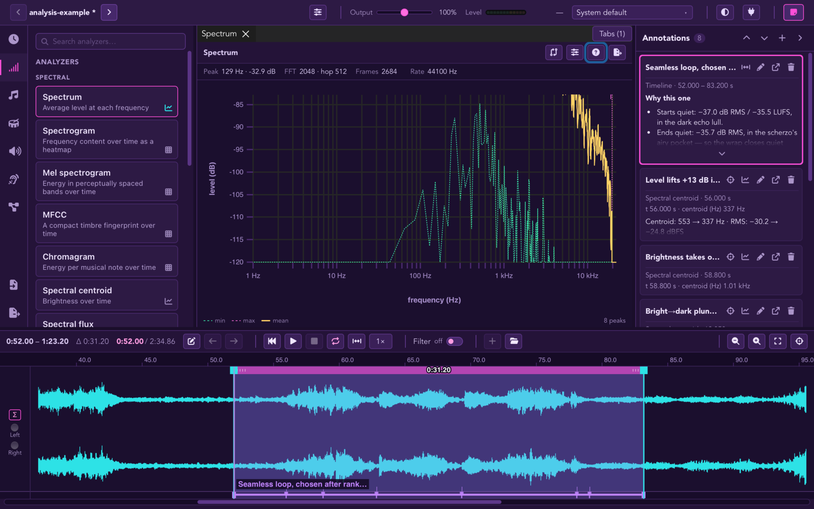

# 006 — Annotate what you find

Annotations are your notes, attached to a moment or a span of the recording.

## Add one

- From the **Annotations** panel: **Add annotation**.
- From the Timeline: right-click, or **Add an annotation at the analysis window**.
- From the transport: **Add an annotation at the playhead** while previewing.
- From a chart tab: annotate the chart you are looking at.

A new annotation opens its editor. Writing your note does not move the analysis window
or the playhead — you are recording what you see, not changing it.

## What an annotation remembers

For a chart annotation, Hey Listen freezes the values and settings you saw when you made
it. Edit the project, change the FFT, re-run the analysis — the note keeps the reading you
wrote about. Write the note in Markdown.

## Select, locate, review

Selecting an annotation highlights it across every time-based chart, so you can find the
same moment everywhere. Close the Annotations rail and the Toolbar keeps a count, with
the selection cleared — nothing is lost.

- **Analyze** moves the analysis window onto an annotation when you decide you want to.
- **Next** and **Previous** step through your annotations in time order.
- Open an annotation in its own window to edit it alongside the charts.

## Delete

Remove an annotation from the panel or its window; it disappears from every chart.

Next: [Compare two projects](007_compare.md)
