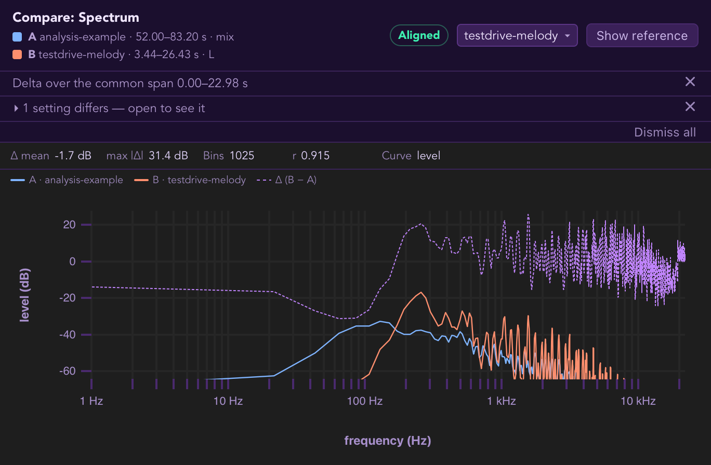

# 007 — Compare two projects

**In short.** Hey Listen compares **projects**, not two tracks in one window: the same
analyzer on two recordings, each with its own window, filter, and options. The point is
not that the curves differ; it is whether they differ for a reason you can trust.



## The simple path

1. Open the second recording in its own project window: **File → New Window**, then open
   or record its source.
2. In the first project, open the analyzer you care about.
3. Right-click its tab and choose **Compare with…** (or use **Analysis → Compare with…**
   with the analyzer focused), then pick the other project.
4. A compare tab opens beside it. A is the project you started from; B is the reference.
5. Read the header first. It names both sides — project, window, channel — and the badge
   says whether they are **Aligned**.

## Advanced — options and keys

**The chart.** A line chart draws A, B, and Δ (B − A) together, with the delta's own scale
in the readout above it (`Δ mean`, `max |Δ|`, correlation). A heatmap or matrix view draws
one side at a time and offers an A / B / Δ switch, because two images on one canvas would
only hide each other.

**The notice strip.** Above the chart, one quiet line per fact a comparison has to admit:

- *Delta over the common span …* — the two windows differ in length, so the delta covers
  only the part they share.
- *1 setting differs — open to see it* — for example channel, FFT size, or window
  function. A delta across different settings is not a delta.
- *Saved reference*, *Reference closed*, and *The reference audio is stored with the
  comparison…* describe what the B side actually is.

**Relative time.** The sides line up on the start of each analysis window, so two
recordings of different lengths still compare fairly. **Fine-tune B** shifts the reference
on that relative axis; **Reset** returns it to zero.

**Keeping it.** A comparison lives in the owning project. Closing the compare tab, or the
reference window, keeps the last result — live updates stop and a banner says so. The
reference dropdown retargets the same tab instead of opening another, and **Open
reference** / **Show reference** brings the other project forward. **Pop out to window**
gives the comparison its own window.

A **saved** comparison stores the reference's window audio, so it reopens without the
reference project and still produces a delta after you change the FFT or the tool's
options; the reference's audio is re-analysed on this side's grid.

| Key | Does |
| --- | --- |
| `Cmd/Ctrl+1…9` | Switch between the analyzer and its comparison |
| `Cmd/Ctrl+Z` / `Shift+Cmd/Ctrl+Z` | Undo / redo the project's own changes (a comparison is read-only) |

## With an agent

```text
list_projects  { }                                   # labels, windows, saved comparisons
compare_analysis { tool: "spectrum", with: "reference-1", summaryOnly: true }
compare_analysis { tool: "spectrum", with: "/audio/other.heyl" }   # headless
compare_analysis { tool: "spectrum", saved: true, id: "…" }         # the saved snapshot
```

The reply carries both sides' summaries, the comparability facts, the relative alignment,
and the per-family delta. `bOffset` shifts the reference on the relative axis, exactly as
**Fine-tune B** does. B is read-only: a comparison never changes the reference project's
audio, window, parameters, or tabs.

The last successful comparison is stored in the owner project, so `save_project` writes it
and the app reopens it as a compare tab. `open_project_window` opens a reference in a
second window when you want to watch a live comparison.

## From the command line

```sh
hey-listen-cli compare a.heyl b.heyl -t spectrum --summary
hey-listen-cli compare a.heyl b.heyl -t spectrum \
  --a-start 52 --a-end 83.2 --b-start 3.44 --b-end 26.42 --b-offset 0.12
hey-listen-cli compare a.heyl b.heyl -t spectrum --save out.heyl --open-tool spectrum
```

`--overlap` clips both sides to their absolute-time intersection instead of comparing on
the relative axis. `--save` writes the owner project with the reference snapshots added,
which is how a batch leaves behind a comparison the app can reopen.

Next: [Listen, and drive by keyboard](008_preview.md)
