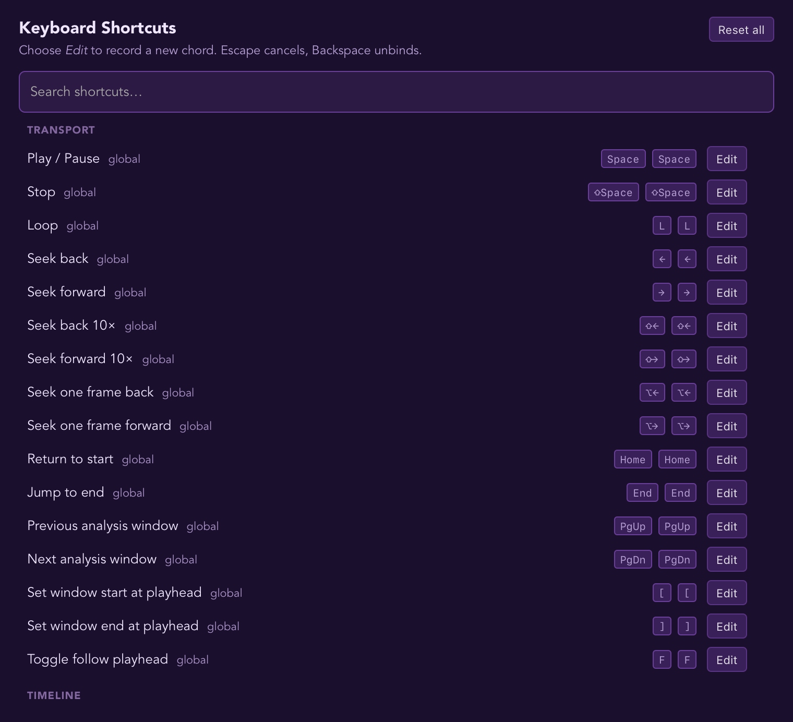

# 008 — Listen, and drive by keyboard

**In short.** Listening is how you check an interpretation. The transport plays the
analysis window, the charts follow a shared playhead, and the keyboard frames a window
without leaving the recording.


## Play the window

1. Press **Play** (or `Space`) to loop the analysis window. **Stop** keeps the playhead
   where it is; the return-to-start button jumps back.
2. Choose the **output device** and **gain** in the Toolbar, and watch the **Level** meter.
3. Move the analysis window while it plays and the preview reloads onto the new region
   instead of playing audio you can no longer see.
4. Open the speed popover to change the rate. Slowing down changes what you hear, never
   what is measured.

The scale is logarithmic, so half and double speed feel equally far from normal. While you
listen, the playhead is drawn on every time-based chart — waveform, spectrogram, pitch
track — so a moment you hear is a moment you can read.

## Advanced — loop, follow, and bindings

- **Loop** (on by default) plays the window round; with it off, playback stops at the end.
- **Follow the playhead** scrolls the Timeline to keep a playing playhead visible.
- The position readout is `playhead / source duration`, independent of the window.
- A preview that will not start reports why in the Toolbar; retrying clears the message
  once playback works.

| Key | Does |
| --- | --- |
| `Space` / `Shift+Space` | Play or pause / stop |
| `L` | Loop the window |
| `←` / `→` | Seek (1% of the visible span); `Shift` for ten steps |
| `Alt+←` / `Alt+→` | Seek by one sample frame |
| `Home` / `End` | Playhead to the start / end |
| `F` | Follow the playhead |
| `?` | Keyboard Shortcuts |



**Change your bindings.** The window lists every command by category
with its current chord, plus the native menu's fixed keys (New, Open, Save, Save As, New
Window, Quit). Search for a command, then record a new binding: `Escape` cancels, a bare
`Backspace` unbinds, and a chord already used by another command in an overlapping scope
is refused rather than silently stolen. **Reset all** restores the defaults. A rebind
takes effect immediately.

Typing in a search field never triggers a shortcut.

## With an agent

```text
preview            { start: 52.0, end: 83.2, loop: true, speed: 0.5 }
stop_preview       { }
set_output_gain    { gain: 0.8 }
list_output_devices { }
```

`preview` defaults to the current analysis window and loops it, so an agent can point at
the moment it is describing and let you hear it. Playback needs the app: headless there is
no output device to play through.

## From the command line

The CLI has no playback and no output device — by design: a batch run must not depend on
a speaker. To check a span by ear, play it in the app, or in any player. To check it by
number, run the analyzers over that window (`--start`/`--end`, or a `--windows` list). See
[Measure what the window contains](005_analyzers.md).

Next: [Keep, undo, and take the data out](009_projects.md)
