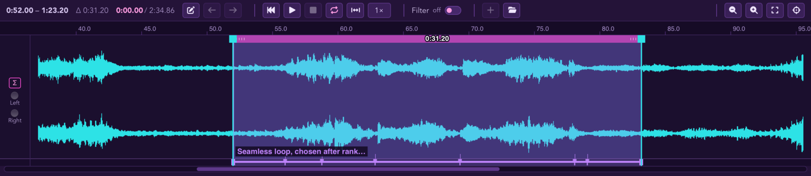

# 008 — Preview and keyboard

## Play a region

The Timeline transport plays the analysis window. Play, pause, resume, seek to the start,
or loop the window. Choose an output device and gain; the meter shows the output level.

A **playhead** is shared across every time-based chart, so while you listen you can see
where you are in the waveform, the spectrogram, and any analyzer at once. Moving the
window reloads a playing preview onto the new region.

## Change the speed

The speed control runs from 0.25× to 4×, with 1× at the centre, and it is logarithmic so
half-speed and double-speed feel equally far from normal. Slowing down changes what you
hear, never what is measured.

## Keyboard

- **Space** — play or pause the transport.
- **← / →** — seek the playhead, with the Timeline announcing where it landed.
- **N** — add an annotation at the playhead.
- **Ctrl/Cmd + K** — open the command palette and run any command or tool.
- **?** — open the Keyboard Shortcuts window.

Typing in a search field never triggers a shortcut.

## Change your bindings

Open the Keyboard Shortcuts window to search commands, record a new binding, or reset
them all. A binding that is already taken is refused rather than silently stealing the
key, and a rebind takes effect immediately — the old key goes inert.

Next: [Projects, undo, and export](009_projects.md)
