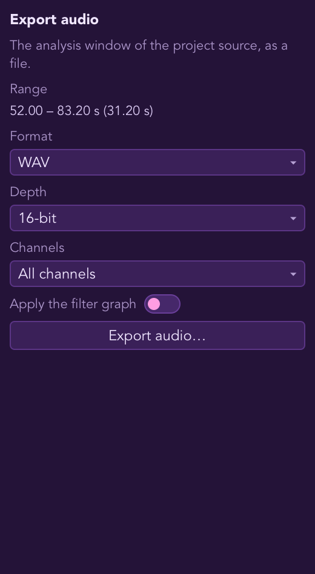

# 009 — Keep, undo, and take the data out

**In short.** A project is one window, one source, one workspace, and a `.heyl` file keeps
all of it. Undo steps back through edits; exports take the evidence out in a form that
still says where it came from.


## The simple path

1. **Save** (`Cmd/Ctrl+S`) writes the project; **Save As…** (`Shift+Cmd/Ctrl+S`) writes a
   copy. The name in the Toolbar carries a dot while there is unsaved work.
2. **Open Project…** (`Cmd/Ctrl+O`), **Open Recent**, or open the file from your operating
   system. **New Project** (`Cmd/Ctrl+N`) starts empty; **New Window**
   (`Shift+Cmd/Ctrl+N`) starts a second, independent project.
3. The arrows beside the project name step to the previous/next project in the same
   folder (`Alt+Cmd/Ctrl+←/→`).
4. **Undo** (`Cmd/Ctrl+Z`) and **Redo** (`Shift+Cmd/Ctrl+Z`) step through the project's
   edits. Inside a text field, the field's own undo applies instead.

A `.heyl` file carries the source (with its storage mode), the filter and synth graphs,
the shared parameters and per-tool options, the analysis window, your annotations, the
Workbench tabs, and any saved comparisons — including the reference audio those
comparisons need.

## Advanced — options and keys

- **Older files** open normally and are upgraded on open; the Toolbar says `upgraded from
  vN` until you save, which writes the current version.
- **A missing link** opens the project with an empty Timeline and a dialog to locate the
  file again; saving an unresolvable link offers to embed the audio still in memory.
- **Two projects at once** are fully independent: their own source, window, tabs, and
  popouts. A popped-out tool belongs to the project that popped it out.
- **Replacing the source** starts a fresh undo history, because the old edits belong to
  audio that is no longer there.
- Closing a project with unsaved work asks first.

**Data out.** The **Export** popover on any analyzer tab, and the same actions on its tab
menu:

- **Data → JSON…** — a self-describing envelope: what ran, on which window, with which
  settings.
- **Data → CSV…** — a wide matrix, with a metadata sidecar (the checkbox controls it).
- **Chart → PNG…** — the chart exactly as drawn, with its theme and zoom.
- **Copy CSV** — the same matrix onto the clipboard.
- **Export all open analyses…** — one file per open tool, into a folder.

**Audio out.** The **Export** activity tab writes the analysis window as a file.



Choose **Format** (WAV, FLAC, AIFF), **Depth** (every depth the format supports), and
**Channels** (all, a mono downmix, or one channel — with the filter applied, the graph's
outputs). **Apply the filter graph** processes the export through your filter,
independent of the Timeline's filter switch. The export never changes the source, the
switch, or the window, and your last format and depth are remembered.

Data export also works without a window; the chart image and the audio need the app.

## With an agent

```text
save_project   { path, storage: "embedded" | "linked", openTools: ["spectrum"], annotations: [] }
open_project   { path }
new_project    { }
export_analysis { tool: "spectrum", format: "csv", path }
export_all      { dir, tools: ["spectrum", "pitchYin"] }    # headless takes the list
export_chart    { tool: "spectrum", path }                  # app only: needs the canvas
```

An interactive **Save** keeps the open tabs and saved comparisons. A headless
`save_project` writes what you pass: the source and its storage, the setup, the
annotations, and the tabs to restore — there is no layout to write without a window.

## From the command line

```sh
hey-listen-cli project out.heyl --source song.wav --storage embedded \
  --start 52 --end 83.2 --open-tool spectrum --annotations notes.json
hey-listen-cli analyze song.heyl -t spectrum --out analysis/ --format json
hey-listen-cli migrate old.heyl              # upgrade one file in place (keeps a .bak)
```

The CLI writes the same container the app reads, and `migrate` upgrades a file in place
(incrementally, atomically, with a backup unless `--no-backup`). A batch can therefore
build projects, analyze them, and hand them to a person to open.

Next: [Change the look, update, read the log](010_appearance_and_log.md)
