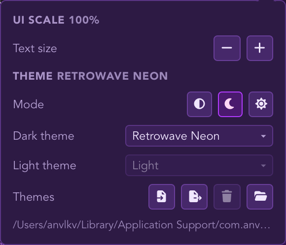

# 010 — Change the look, update, read the log

**In short.** Appearance is a personal setting, not a project one: it is stored for the
app, and it styles charts and graph editors as well as the shell. The same corner of the
menus installs the CLI and opens the log when you need to see what the app was doing.



## The simple path

1. Open **Appearance** in the Toolbar.
2. Set **Text size** if everything feels small or large.
3. Choose the **Mode** — *Auto*, *Dark*, or *Light*. *Auto* follows your system.
4. Pick a **Dark theme** and a **Light theme** separately, so each mode keeps its own look.

Themes apply instantly, to the Workbench and to the charts drawn inside it.

## Advanced — options and keys

- **Themes.** Import a `.heyltheme` file to add one, export the current theme to share it,
  delete a theme you no longer want, or reveal the themes folder to edit a file by hand.
- **Charts are themed too.** A chart's colours come from the theme, so a screenshot taken
  in one theme matches the app in that theme.
- **Updates.** *Help → Check for Updates…* checks and reports in the About dialog.
- **The command line tool.** *Help → Install Command Line Tool…* reads the real install
  state and offers the matching action: **Install** when absent, **Update** when stale,
  **Repair** otherwise, plus **Uninstall**. The installed copy's version follows the app.
- **The log.** Every analysis and comparison is written when it starts and finishes, with
  its elapsed time and outcome, and repeats while it is still running — so a slow run is
  identifiable instead of silent. *Help → Show Log…* opens a window over it (with a filter
  and a follow toggle); *Open Log Folder* reveals the file.

## With an agent

```text
list_themes  { }
get_theme    { id: "retrowave-neon" }     # the full palette
set_theme    { mode: "dark", darkThemeId: "…", lightThemeId: "…" }
import_theme { path: "/themes/mine.heyltheme" }
export_theme { path: "/themes/mine.heyltheme", id: "…" }
```

The theme preference is app-level and is not written into a project, so an agent that sets
it changes your window, not the file. Headless, only the bundled themes are listed.

The analysis log is a file, not an MCP resource: read it from disk if you need to explain
a slow run.

## From the command line

```sh
hey-listen-cli --version     # the CLI's version follows the app's
hey-listen-cli --help
```

The CLI has no theme: it prints data, not a window. It links the same core, so a result
computed by a script and one computed on screen carry the same numbers and the same
envelope.

Next: [When something goes wrong](011_errors.md)
