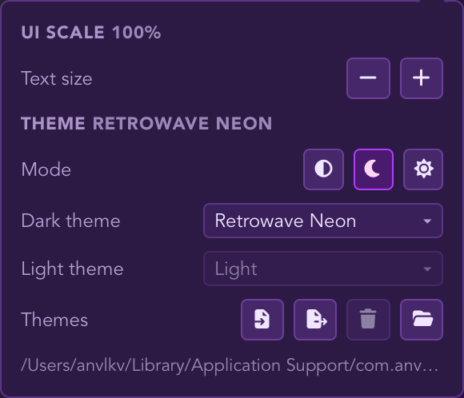

# 010 — Themes, agents, and the command line

## Change the look

Choose **Auto**, **Dark**, or **Light** to follow your system or pin a base. Each base
has its own theme slot, so light and dark can use different themes. Themes style charts
and graph editors as well as the shell, and there is a UI scale if everything feels too
small or large.

Import and export theme files to share a look, reveal a theme on disk to edit it, or
remove one you no longer want.

## Let an agent do the groundwork

Open the **MCP** control in the Toolbar, enable the server, and copy the snippet into your
agent's configuration. An agent can then open a source, change settings and graphs, run
analyses, preview, annotate, compare, export, and save.

When the app is open, the window follows along so you can watch. Without an app, the same
surface works headlessly.

Ask for the amount of detail you need: a short summary, a compact preview, or the full
arrays. A run can avoid opening a tab, and a one-off run can skip changing your setup.

## Work from a shell

The standalone **hey-listen-cli** analyzes files and windows into JSON, renders synth
graphs, creates projects, compares projects, and reads or edits a saved project's
annotations — no window required. Install, update, or repair it from **Help → Install
Command Line Tool…**. Its version follows the app.

## Know what happened

Every analysis and comparison is written to the app log when it starts and finishes,
with its elapsed time and outcome, and repeats while still running — so a slow run is
identifiable instead of silent. Open the log from the **Help** menu.

Next: [When something goes wrong](011_errors.md)
