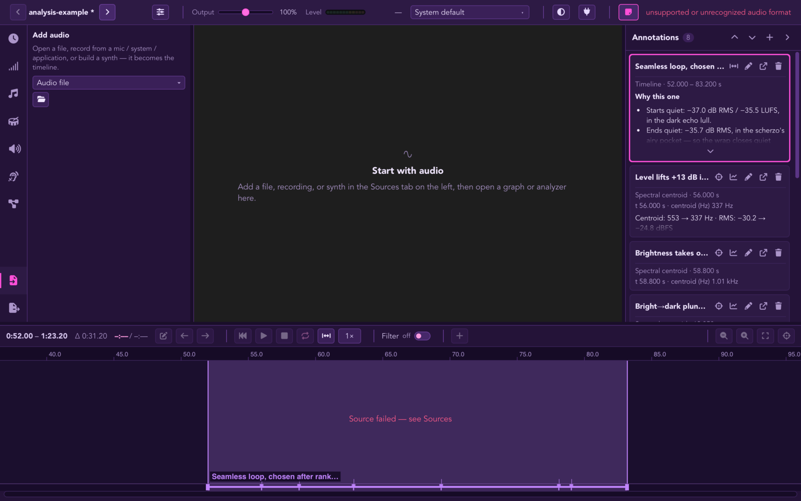

# 011 — When something goes wrong

**In short.** Hey Listen reports a failure where the failure happened, and keeps the rest
of the window usable. Nothing is half-loaded: a file that will not open leaves an empty
Timeline and a message, not silence that looks like a quiet recording.



## The simple path

1. Read the message where it appeared — the Toolbar, the Sources rail, the analyzer tab,
   or the graph editor.
2. Fix the cause and retry. Most errors clear on the next successful action.
3. If an edit went wrong, undo it. If a whole session went wrong, reopen the saved
   `.heyl` — a file is a repeatable starting point.

## Advanced — options and keys

| What you see | What it means |
| --- | --- |
| A Toolbar error, empty Timeline, `Source failed — see Sources` | The file could not be probed or decoded. Nothing from it was kept. |
| An error inside an analyzer tab | That run failed. The tab stays open; adjust the window or the options and run again. |
| A graph error, previous graph kept | The graph was rejected. Its applied/bypassed state is unchanged until you fix it. |
| A graph warning: *Output is not connected* | The graph produces no output, so there is nothing to hear or measure. |
| A failed render | The graph editor or the Sources rail reports it; **Render** becomes available again. |
| A banner about the output device | The device disappeared or is busy. It clears when a device is available again. |
| A preview that will not start | The Toolbar reports it; retrying clears the message once playback works. |
| A project that will not open | The Toolbar reports it. A *missing link* is different: the project opens with the audio gone. |

The app log records the same failures with timestamps. *Help → Show Log…* opens it;
*Open Log Folder* reveals the file. A slow analysis also appears there, with repeats while
it is still running, which is how you tell "still working" from "hung".

## With an agent

A failed call comes back as an error, not as an empty result, so an agent should report
the failure rather than reason about zeroes:

- A bad path or an undecodable file fails `open_audio_file`.
- An unknown tool or option key fails the call instead of being ignored (option keys are
  validated against the catalog).
- `compare_analysis` returns the comparability facts even when the delta is limited; read
  `mismatches` and `alignment.common` before claiming a difference.

Headless there is no Toolbar: the error is the answer. On the bridge the window also shows
it, so you can see what the agent sees.

## From the command line

The CLI writes one JSON line per result, and a failing file or tool is reported in that
line rather than aborting the batch:

```sh
hey-listen-cli analyze *.heyl -t spectrum --fail-fast   # stop at the first failure
```

Exit codes:

- `0` — every file and tool succeeded.
- `1` — at least one failed, or the output could not be written.
- `2` — a usage error (a bad argument, an unknown option, an unusable `--filter`).

Without `--fail-fast`, one bad file does not hide the good results beside it.

Back to [the manual index](README.md)
